# Glide Image Viewer

> **Glide 5.0.5 is available:** download the [installer or portable archive](https://github.com/cobhc95/Glide/releases/latest). 5.0.5 is a usability round from tester feedback: Ctrl+E can open a picture's folder in the same tab with Back returning to the picture, finer Explorer scrolling, and an alternative file manager option ([release notes](docs/releases/release-notes-5.0.5.md)). Since 5.0.4, many more formats now open out of the box, HEIC, AVIF, JPEG XL and camera RAW among them, with Explorer thumbnails for every format Glide decodes and Save as writing about 30 formats. 5.0.4 also adds Back up and restore, and Glide is now licensed under GPL-3.0-or-later. See [What changed since 4.7.1](#what-changed-since-471).

## Fast. Multi-tabbed. Multi-window. Highly customizable.

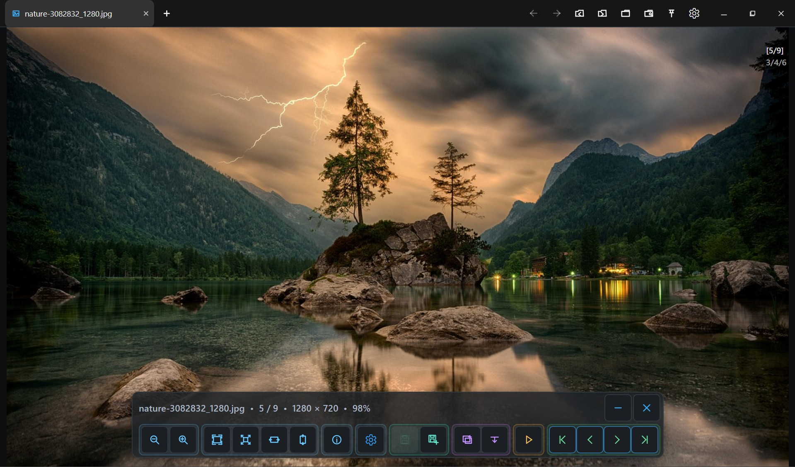

**Glide is a Windows image viewer built to feel instant: a compact installer, a window that opens before you notice, tabs and multiple windows, a built-in Explorer tab, live folder refresh, Save and Save As with format conversion, transparent Window-in-Window overlays, one panel for every mouse gesture, a hotkey for almost everything, animated GIF playback, complete printing, native SVG and Photoshop support, Windows Open With and Explorer thumbnails, and 196 recognised file extensions.** Everything is configurable, there is no telemetry (the only thing Glide ever asks the internet is, once a day, whether a newer version exists; one switch turns that off), and no .NET runtime is needed.

[Download](#download-and-install) | [What changed since 4.7.1](#what-changed-since-471) | [Feature tour](#feature-tour) | [Default shortcuts](#default-shortcuts) | [Formats](#recognized-and-routed-formats) | [Build](#building-from-source) | [Docs](#documentation)

## Download and install

Windows x64 only. No .NET runtime is required. Get the files from the [latest release](https://github.com/cobhc95/Glide/releases/latest):

* **`Glide.Setup.exe`**: the installer (requires administrator rights). Installs to Program Files by default, adds Glide to Windows' Open With menu, registers Explorer thumbnails and, with *Integrate with Windows* (on by default), opens Windows' Default apps page for Glide.
* **`Glide-5.0.5-Portable.zip`**: the portable build. Extract it anywhere and run `Glide.exe`; no installation or administrator rights are needed.
* **`Glide.Setup.sha256`**: the installer's checksum. To verify the download, run `certutil -hashfile Glide.Setup.exe SHA256` and compare the result with the value in this file.

Upgrading from 5.0.x or 4.x keeps your settings (older files are migrated once, and your own key bindings and customised title bar are kept). The installer closes Glide before upgrading.

---

## What changed since 4.7.1

**5.0.1 (2026-11-15) is a polish release with three main points:**

* 🧱 **.NET 10 LTS.** .NET 8 support ended on 2026-11-10, so Glide now builds on .NET 10 LTS. `Glide.exe` is about 10 % smaller (40.5 to 36.6 MB), image opening, navigation and memory are unchanged, a headless start-to-exit run is about 27 % faster, and the installer requires Windows 10 version 1607 or later. Still one self-contained exe, no runtime to install.
* 🗂️ **Safer file operations** (from an external code audit): a folder move to another drive no longer deletes files that arrive or change during the move; a multipage TIFF or animated image can no longer be overwritten in place with only its first page (*Save* refuses, *Save as* warns); rename and Recycle in the viewer no longer freeze the window on a slow share (and the viewer's rename supports case-only renames like the Explorer tab); the optional video decoder is rehashed before it is loaded.
* 🔔 **A daily update check:** one small request to GitHub once a day, a prompt that only opens the release page, *Don't remind me again*, a new *Updates* card in Settings > General & startup and a *Check for updates now* action. Off with one switch; Glide never downloads or installs anything.

Details: [5.0.2 release notes](docs/releases/release-notes-5.0.2.md), [5.0.1 release notes](docs/releases/release-notes-5.0.1.md) and the [changelog](CHANGELOG.md).

5.0.0 is the biggest Glide release so far. (4.8.0 was never published; everything built for it is part of 5.0.0.) Thanks to vertigo220, whose detailed bug reports and feature ideas shaped it: see [Thanks](#-thanks).

### ⚡ Opening speed: v4 vs v5

Time until the viewer shows its final sharp frame at Fit (median milliseconds, warm cache, lower is better). The bar is how much of the time is gone.

| Format | v4 | v5 | Change | Faster |
|---|---:|---:|---:|---|
| 🖼️ JPEG, 24 MP | 83 | 46 | -45 % | ▓▓▓▓▓░░░░░ |
| 🖼️ Progressive JPEG, 50 MP | 978 | 107 | -89 % | ▓▓▓▓▓▓▓▓▓░ |
| 🖼️ PNG, 24 MP | 154 | 127 | -17 % | ▓▓░░░░░░░░ |
| 🖼️ WebP, 24 MP | 378 | 184 | -51 % | ▓▓▓▓▓░░░░░ |
| 🖼️ TIFF (LZW), 24 MP | 585 | 177 | -70 % | ▓▓▓▓▓▓▓░░░ |
| 🖼️ BMP, 24 MP | 123 | 27 | -78 % | ▓▓▓▓▓▓▓▓░░ |
| 🎞️ GIF, animated 1080p x 60 frames (first frame) | 6.0 | 5.0 | -16 % | ▓▓░░░░░░░░ |
| 💯 JPEG, 100 MP | 258 | 124 | -52 % | ▓▓▓▓▓░░░░░ |
| 💯 Progressive JPEG, 100 MP | 980 | 201 | -80 % | ▓▓▓▓▓▓▓▓░░ |
| 💯 TIFF (LZW), 100 MP | 2333 | 756 | -68 % | ▓▓▓▓▓▓▓░░░ |
| 💯 PNG, 100 MP | 634 | 530 | -16 % | ▓▓░░░░░░░░ |
| 💯 BMP, 100 MP | 362 | 98 | -73 % | ▓▓▓▓▓▓▓░░░ |
| 🧠 Peak memory of a full decode, 24 MP / 100 MP (MB) | 184 / 770 | 93 / 385 | -50 % | ▓▓▓▓▓░░░░░ |
| 🔋 CPU to browse 21 x 24 MP images at 500 ms per step (s) | 11.5 | 4.8 | -58 % | ▓▓▓▓▓▓░░░░ |
| 🔋 CPU to browse 21 x 4K images at 500 ms per step (s) | 9.9 | 1.0 | -90 % | ▓▓▓▓▓▓▓▓▓░ |
| 🗂️ Explorer, 5000 files: visible thumbnails (ms) | 87 | 68 | -22 % | ▓▓░░░░░░░░ |

JPEG decoding itself is limited by the Windows codecs, so the very first frame of a JPEG is unchanged (24 MP: 36.7 vs 37.2 ms); the gains come from refinement, memory and browsing. Stepping through a folder with prefetch is a cache hit in both versions (about 0.15 ms). A 1080p 60-frame GIF now animates; in v4 it exceeded the animation memory budget and stayed still. *Method:* headless benchmark harness (`tools/perf`) on an AMD Ryzen 7 9700X (16 logical CPUs, 61.6 GB RAM, Windows 11 24H2), factory defaults (Maximum quality, 2400 px preview cap, prefetch depth 15, 999 MB caches), a 2560x1369 viewport, synthetic test images, medians of 5 warm runs (3 for 90 MP and above). "v4" is the pre-5.0 source (4.7.1 behaviour plus unreleased 4.8 work). Synthetic JPEGs are about half the size of real camera JPEGs, so absolute JPEG times are optimistic; the comparison is like-for-like. Your numbers will vary with your PC.

### 📊 v4 vs v5 at a glance

| | v4 (4.7.x) | v5.0.1 |
|---|---|---|
| Explorer tab | ❌ (the option was hidden and removed in 4.7.0) | ✅ full file browser with thumbnails, file operations and session restore |
| Back / Forward history in every tab | ❌ | ✅ up to 100 steps per tab, title-bar buttons, `Alt+Left` / `Alt+Right`, mouse side buttons |
| Mouse side buttons | ➖ did nothing until bound | ✅ Back / Forward by default |
| Mouse gestures | ➖ a matrix of fixed slots plus separate mouse toggles; no custom gestures, no tab / title-bar / Explorer areas | ✅ one panel, 9 areas, up to 6 custom gestures per area, every row searchable |
| Hotkeys and actions | 75 hotkey rows, 56 gesture actions | ✅ more than 260 actions in one registry behind keys, gestures, buttons and menus |
| Settings as hotkeys or gestures | ❌ | ✅ 132 on/off and choice settings can be bound |
| Settings window | 8 pages, each one long scrolling list; opens at 1040 x 760 | ✅ 8 pages, 41 collapsible cards, results that *Open* and highlight the setting; opens at 930 x 630 and remembers its size |
| Searchable settings entries | 202 documented at 4.6.0 | ✅ 271 |
| Window memory | ➖ main window and Settings | ✅ every window, including Print and the dialogs |
| Status bar | one line in a wide window | ✅ info line stacked on its own row by default, auto-hide, reveal area equal to the bar, reserve-space option |
| Print preview, Portrait / Landscape click | 540-570 ms (seconds on a network printer) | ✅ instant |
| Print window opened later in a session | about 550 ms | ✅ 35-61 ms |
| Largest image at full resolution | 256 MP | ✅ 512 MP, with a free-memory check |
| Animated GIF controls | ❌ | ✅ pause / play and frame stepping |
| Explorer thumbnail quality settings | ➖ saved but ignored | ✅ Fast / Balanced / High really work |
| Zoom step setting | ➖ had no effect | ✅ works (default 15 %) |
| Reset Glide | ❌ | ✅ wipe exactly the data you choose |
| Security gaps from the full review | ➖ present (SVG remote images, imported profiles, malformed GIFs, installer folder rights ...) | ✅ closed |

### 🆕 What's new

* 🗂️ **Explorer tab**: thumbnails, breadcrumb bar, navigation pane, rename, copy / cut / paste, Recycle Bin delete, drag and drop; *Open last session* restores each tab's folder, selection and scroll position, even after a crash.
* ⏪ **Back / Forward** like a web browser, per tab; `Backspace` goes Back or to the previous image.
* 🖱️ **One panel for every mouse gesture**, custom gestures, mouse side buttons, tab and title-bar clicks, Shift / Alt + wheel.
* ⌨️ **Everything on a key or a gesture**: one master action list, 132 settings as *Toggle:* / *Cycle:* actions, sortable list, *Search hotkey*, custom presets, a prompt before a used shortcut is reassigned.
* 🧩 **Settings in collapsible cards**, a compact 930 x 630 window, *Expand all* / *Collapse all*, *N changed* badges, search results that open the exact setting.
* 📊 **Status bar**: stacked info line, auto-hide, hover reveal exactly where the bar appears, reserve space when fitting, tab tooltip text size.
* 🧹 **Reset Glide** card; 🪟 every window remembers its place; 🖨️ instant print preview; 🎞️ GIF controls; 📁 folders as Custom startup / new-tab targets; 🖼️ 512 MP images.
* 🔔 **Update check** (new in 5.0.1; the rest of this list is 5.0.0): once a day Glide asks GitHub whether a newer version exists and offers to open its release page. Nothing is ever downloaded or installed by Glide, *Don't remind me again* and *Check for updates once a day* are in Settings > General & startup > Updates, and *Check for updates now* is an action you can put on a key.

### 🐞 Fixes in short

* ⌨️ Shortcuts saved in another modifier order now work · image shortcuts no longer act on the picture of another tab · Space / Enter after clicking a button · Ctrl+Tab follows your keys · Tab and arrow combinations can be recorded · zoom step works · Fit hotkeys follow *Fit control scope* · *Exit Glide* really exits.
* 🖱️ Right-click menu appears on release (also outside the image) · pointer stays visible over menus in fullscreen · tooltips no longer block list scrolling · no flash when leaving fullscreen.
* 🖨️ Portrait / Landscape and the other layout options no longer lag · 🖼️ rotated and GIF Explorer thumbnails and the thumbnail quality settings · image-cache lifetime bugs · a hidden-tab Delete / rename / external-program mix-up.

### 🔐 Security in short

SVG files can't fetch remote images · imported profiles can't change external programs or bring network folders · malformed GIFs and PSDs are bounded · 512 MP limit with a memory guard on every decode path · installer and single-instance connection hardened · videos play only with the codecs Windows already has · Glide no longer loads DLLs from an image's folder.

### 🙏 Thanks

Thanks to vertigo220 for the many detailed bug reports and feature ideas that shaped this release: the 21-point report in issue #1 (the status bar and tab tooltip options, the Settings scroll memory, the hotkey conflict prompt, sortable shortcuts, *Search hotkey*, custom presets, the right-click menu timing and more), the Explorer tab request with session restore, and the GIF controls. See [the feedback map](docs/releases/5.0.0-community-feedback.md).

Full details: [5.0.1 release notes](docs/releases/release-notes-5.0.1.md), [5.0.0 release notes](docs/releases/release-notes-5.0.0.md) and the [changelog](CHANGELOG.md). The move from .NET 8 to .NET 10 LTS is described in the [migration notes](docs/NET10-MIGRATION-PLAN.md); next up is stabilisation (consolidating brittle tests, empty `catch` review, splitting `MainWindow`, moving the remaining file work off the UI thread).

---

## Feature tour

A review of every area of Glide, written from what the product does today. Screenshots are real 5.0.0 captures; where a section has none, it is written without one.

### Home / Welcome page

The Welcome tab is the quiet front door: your recent files and folders as a list, an *Open image* button and nothing else. In 4.7.0 it was stripped down from a wall of feature cards after feedback that it looked like a set of options; it is now only useful things. You choose what Glide opens at launch (Welcome tab, *Open last session*, an Explorer tab, or a *Custom* path that can be an image or a folder) and what a new tab opens independently, and the recent-history size is yours to set. A custom path that no longer exists falls back to the Welcome page and says why in the page itself, never in a dialog. *Honest limit:* there is no 5.0 screenshot of the Welcome page yet.

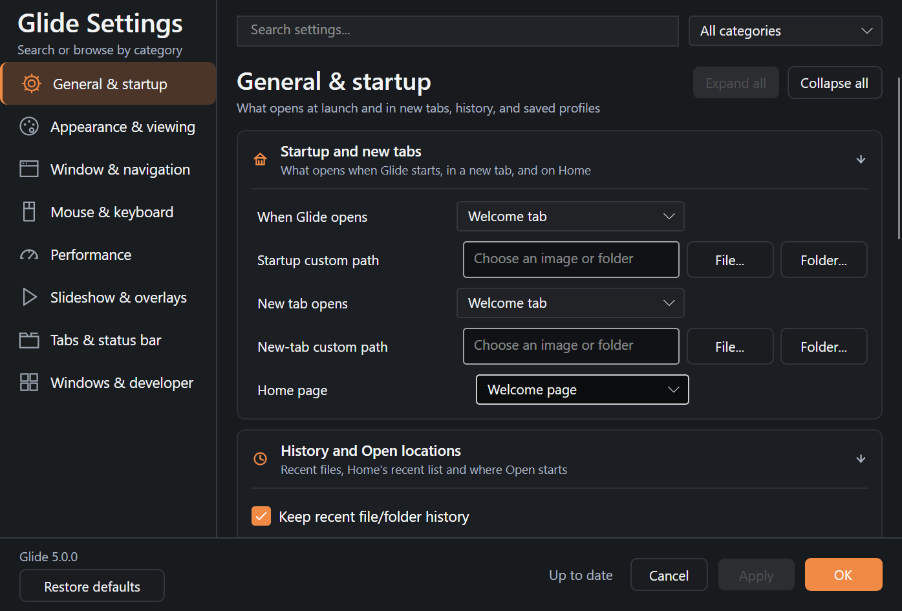

### The viewer: zoom, pan, fit and fullscreen

The viewer is the heart of the program. Images open at the largest size that fits (*Fit to window*, key `4`), or Fit width, Fit height or 100 %; scroll to zoom around the pointer, drag to select a region and click inside it to zoom to it, pan with a drag or the right button, rotate and flip with `L` `R` `H` `V`. The *Viewport zoom step* setting really works now (default 15 %), and the Fit keys follow *Fit control scope*, so a Fit command can apply to one image, this session, or every future image. Fullscreen hides the cursor after 3 seconds, keeps it visible over menus, and leaving it restores your exact window geometry without a flash. Images up to 512 megapixels open at full resolution; before a frame bigger than about 67 MP is decoded at full size Glide checks free memory and keeps the sharp preview if it would need more than half of it. The text overlay (`[index/total]` by default) has a token template, position, font and colour.

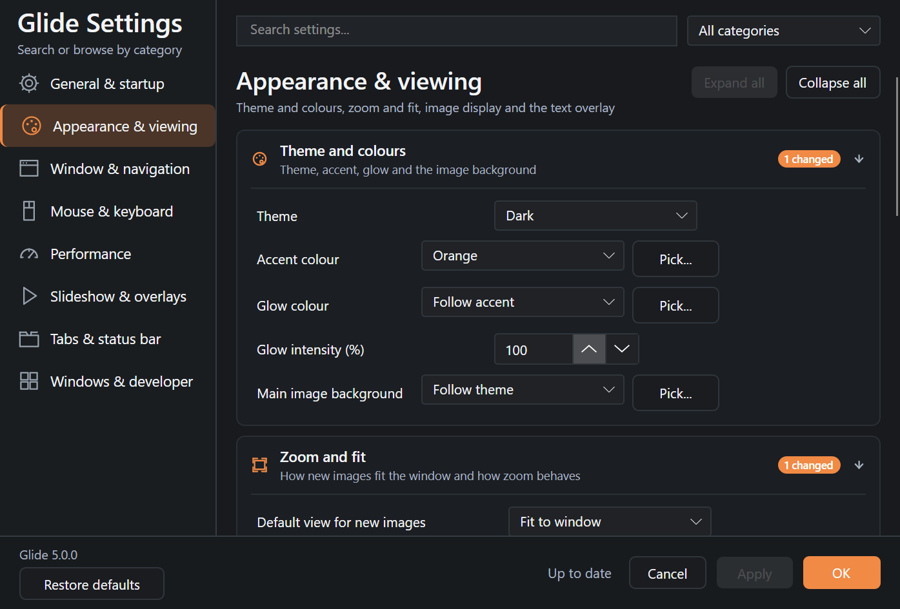
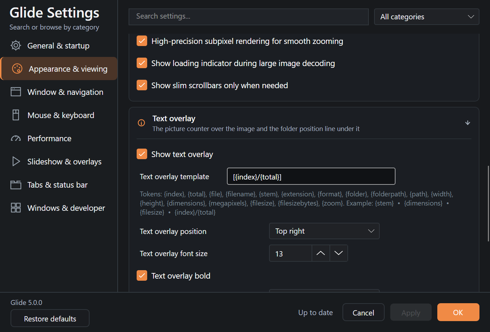

### Explorer tab

New in 5.0.0, and the part that makes Glide feel like a complete tool: a real folder browser inside a tab. A breadcrumb address bar (click a segment, or the empty part to type a path), a navigation pane with Quick access and drives, Extra large to Small icon views plus List and Details with sortable, resizable columns, a filter box (`Ctrl+F`), and thumbnails that load in the background and only for visible tiles. File operations are the ones you expect: right-click menus, inline rename (`F2`), Recycle Bin delete (`Shift+Delete` deletes permanently, with a stronger confirmation), copy / cut / paste through the real Windows file clipboard, new folder (`Ctrl+Shift+N`) and drag and drop (move; `Ctrl` copies). Double-click or `Enter` opens an image in the current tab and a middle-click in a new tab (swap them in the gesture panel). The detail that earns its place: *Open last session* saves every Explorer tab's folder, selection and scroll position about a second after each change, so it comes back exactly as you left it even after a crash. In benchmarks a 5000-file folder shows its visible thumbnails 22 % sooner than before. *Honest limit:* it is Glide's own browser, not Windows File Explorer; for anything beyond it, *Show in Windows File Explorer* is in the right-click menu.

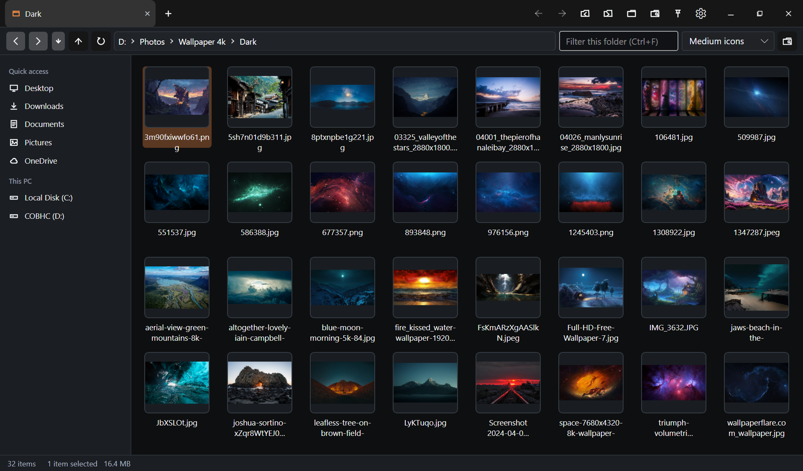

The Explorer reflows from a compact window to an ultra-wide one:

| Compact | Portrait | Ultra-wide |
|---|---|---|
| 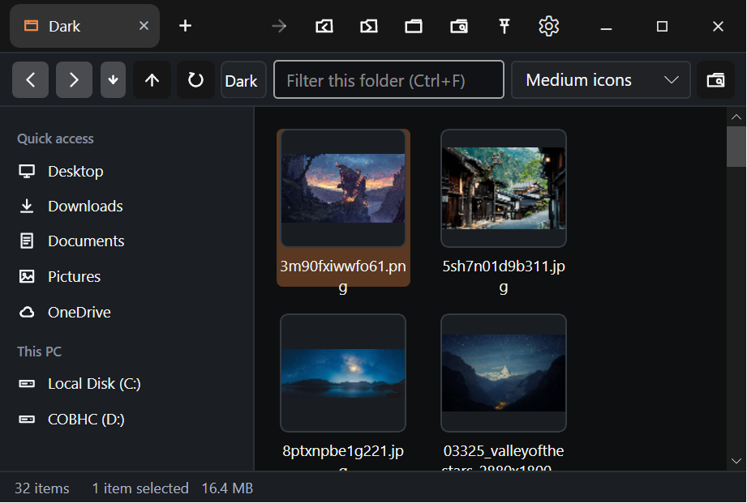 | 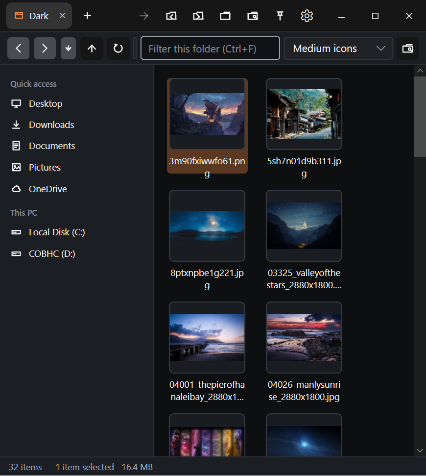 | 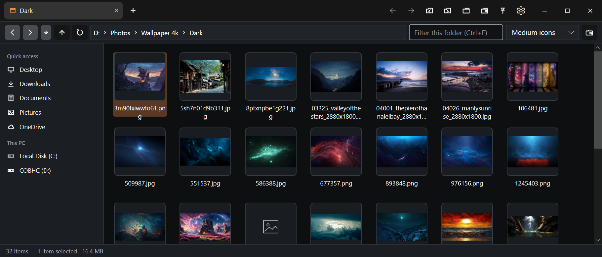 |

#### Back, Forward and history

Every tab keeps a browser-style history of up to 100 steps. Open an image from the Explorer, press Back (`Alt+Left`, the mouse back button or the new title-bar button) and you are in the same folder, scrolled as it was, with that image selected; Forward (`Shift+Backspace`, `Alt+Right`, the mouse forward button) shows the image again. Home to image to Back returns to Home. `Backspace` is *Back, or Previous image*: Back when there is a step back, otherwise the previous image in an image tab. Moving from image to image with the arrows is deliberately not a history step, and Back / Forward never fire while you type in the address, filter or rename boxes. A tab you drag to another window keeps its history. If the target has been deleted Glide skips it and tells you. The Back and Forward buttons lead the title bar in the banner picture above. See [docs/NAVIGATION-HISTORY.md](docs/NAVIGATION-HISTORY.md).

### Tabs and multiple windows

Tabs behave like a browser's: drag a tab out into its own Glide window, drag it back or onto another window, restore recently closed tabs (`Ctrl+Shift+T`), duplicate a tab, cycle with `Ctrl+Tab` in tab order or most-recently-used order, and let the tab strip scroll instead of overlapping when many are open. Every window keeps its own taskbar button. You can decide what happens when the last tab closes, whether a source window closes after its last tab is detached, whether closing a window with several tabs asks first, and whether middle-click or double-click closes a tab. The tab tooltip shows the file name in a text size you choose (Small, Medium, Large) above the full path. *Honest limit:* tab history lives while Glide runs; *Open last session* restores Explorer folder history but not image or Home steps.

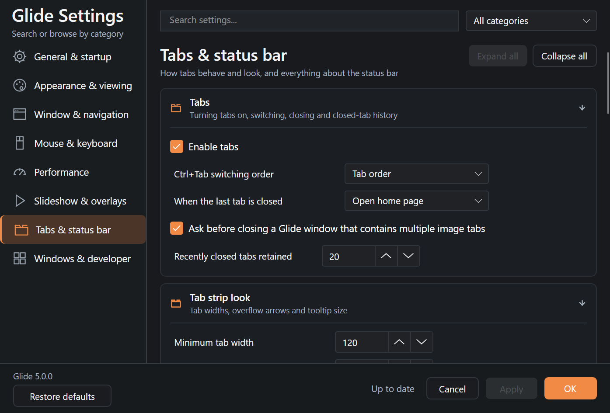
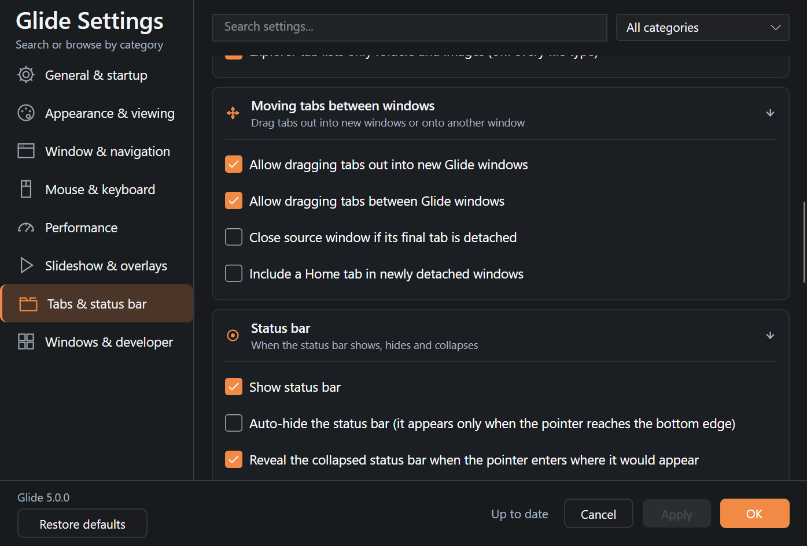

### Status bar

The status bar adapts: its buttons rearrange into rows as the window narrows and move into an overflow menu at very narrow widths, in six sizes. In 5.0 the file info (name, position, size, zoom) sits on its own line above the buttons by default, with minimise and close at its right (switch *Always stack the information on a separate line* off to get a single line in wide windows); the banner picture shows it. It can auto-hide like the Windows taskbar and reveals exactly where it would appear: the invisible reveal area is the bar's own box, tunable from -40 to +300 DIP, never blocks clicks on the image and never triggers while a mouse button is down. *Reserve status bar space when fitting* lets images fit above the bar instead of under it; *Fit control scope* decides how the Fit buttons behave; collapse it to a very small arrow or to the lower-right corner; place it Left, Center or Right; show or hide it with `Ctrl+Shift+B`. *Honest limit:* the stacked bar is a row taller than the old default; one tick turns it off.

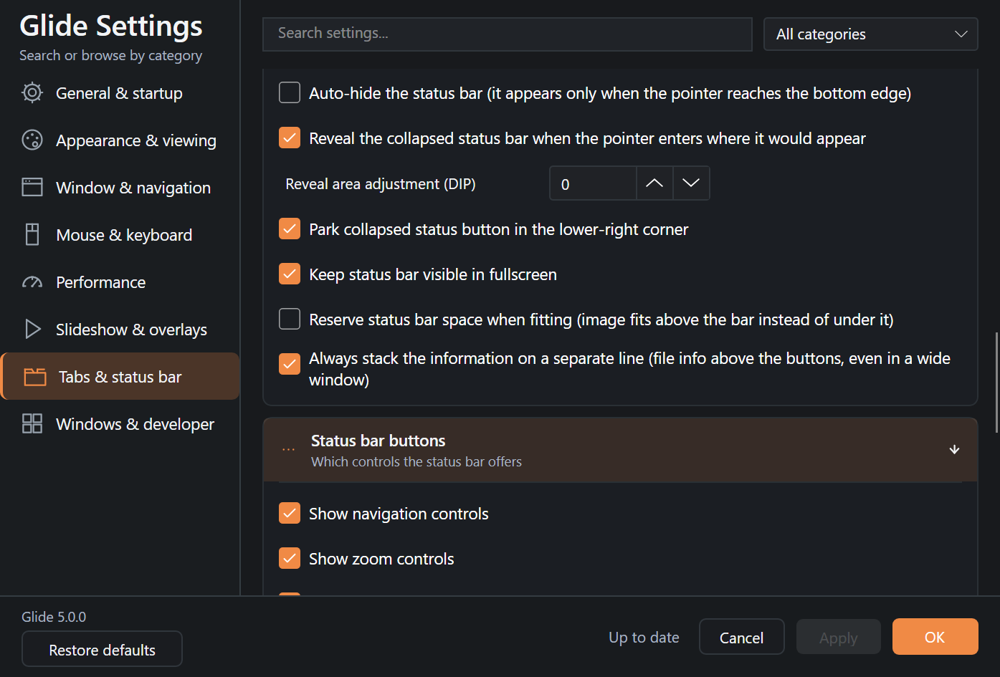
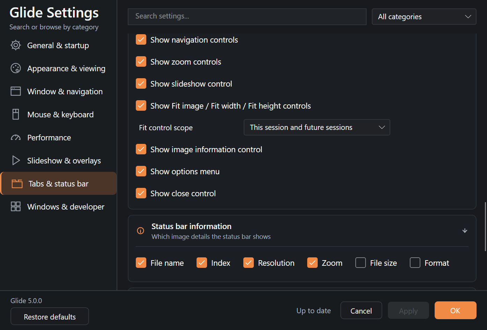

### Title bar buttons and the customiser

The title bar carries the buttons you actually use (the default set leads with Back and Forward, which dim when there is nothing to go to and show your assigned key in their tooltips), and *Customize title-bar buttons* lets you pick and order them from a list that now includes rotate, flip, fit width and height, status bar, Save As and Overlay mode. When the window is too narrow the buttons nearest the window controls stay and the leftmost ones hide first, so Settings is the last to go. Right-click the Always on top button to switch it on or off and choose Hard or Soft mode. The *Show in File Explorer* button opens the image's folder in Glide's own Explorer tab (the default) or in Windows File Explorer with the image selected. A title bar you have already customised is never changed by an upgrade. *Honest limit:* there is no 5.0 screenshot of the customiser window; its size and position are remembered.

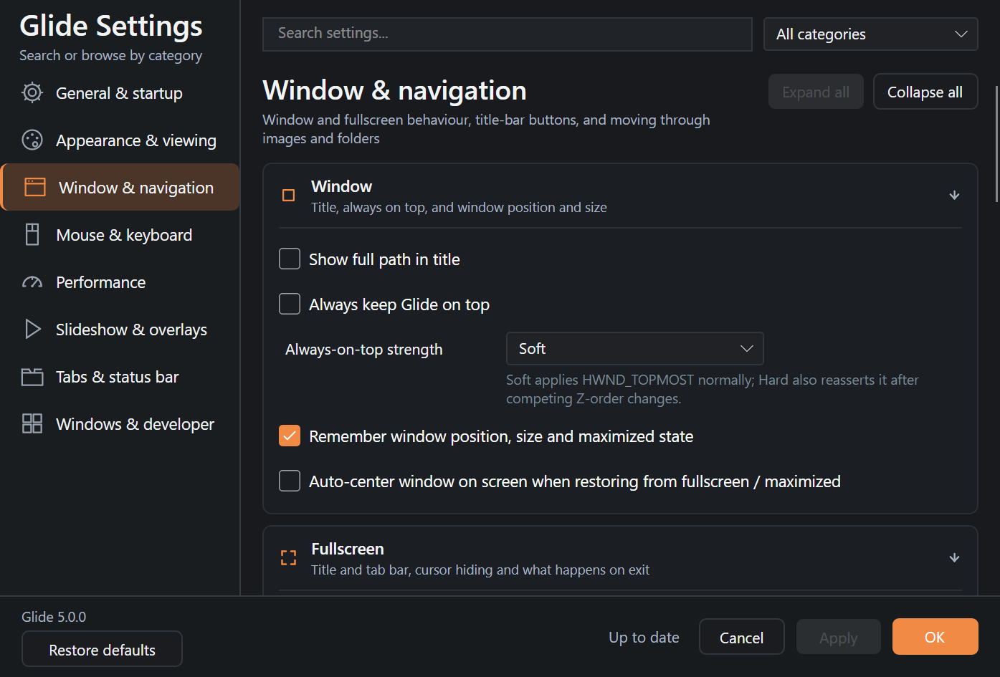

### Mouse gestures

All mouse input lives in one compact panel (Settings > Mouse & keyboard). Pick an area (Windowed image, Fullscreen image, Empty background, Selection, Slideshow, Window in Window, Tabs, Title bar, Explorer) and choose what each click, double click, drag and wheel does there, including Shift + wheel, Alt + wheel and right button + wheel. Unchanged rows say what they do as *Default (...)*; changed rows are outlined, counted and can be reset per area or all at once. Each row's dropdown has *Find an action*, *Default*, *Do nothing*, suggested actions for that input, your recent picks and all actions by category; wheel rows only offer direction-aware actions, drag rows only continuous ones, and no row offers Delete, Close Glide or commands that open a dialog. The mouse back and forward side buttons are inputs too and go Back / Forward by default (choose *Do nothing* to restore the old behaviour). You can add up to 6 custom gestures per area (an input, an optional Ctrl / Shift / Alt, an action), and every row and custom gesture is a Settings search result. Mouse settings from older versions are migrated once, so behaviour is unchanged until you change it.

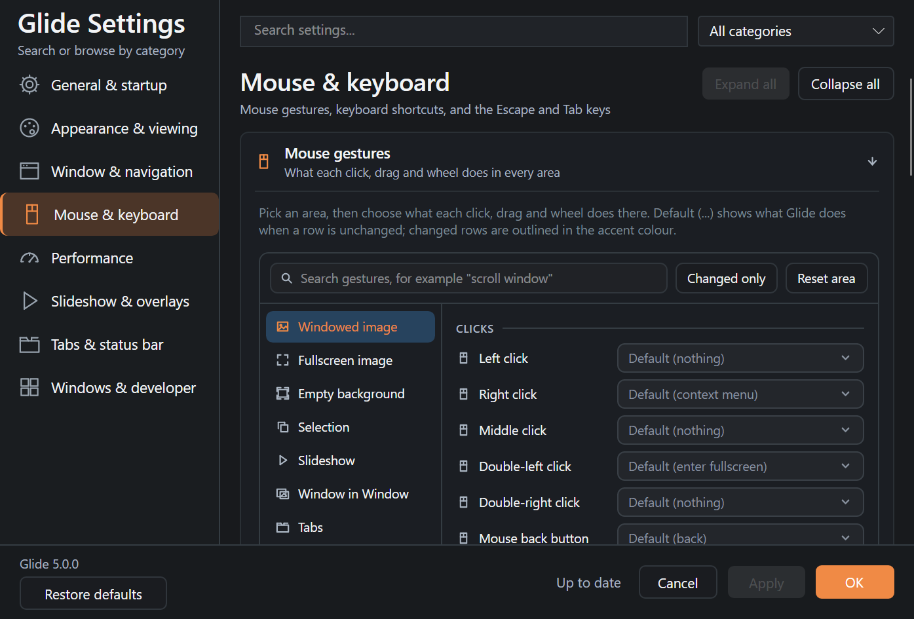
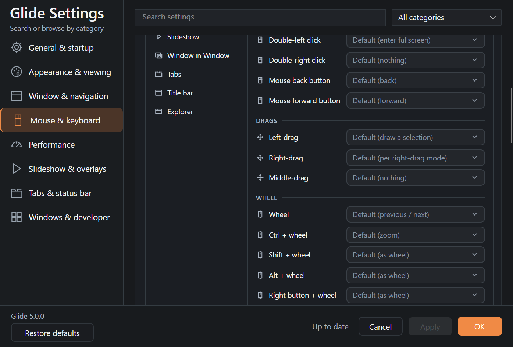
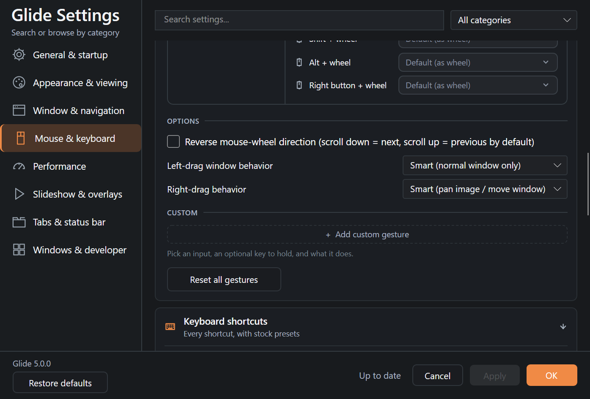

### Hotkeys

Behind every key, gesture, button and menu there is one list of more than 260 actions, so they cannot disagree. All 132 on/off and choice settings appear as *Toggle: ...* and *Cycle: ...* actions you can put on a key or a gesture; 22 commands that could only be clicked before now have a hotkey row; and the keys you cannot change (Explorer's `Ctrl+C` / `F2` / `Delete`, `Space` in a slideshow) are listed and findable. The list sorts by Shortcut, Action or Category, *Search hotkey* tells you what any key is assigned to without running it, and you can save, rename and delete your own presets next to the built-in Glide, Windows Photos, IrfanView, nomacs, FastStone and XnView MP ones. If a shortcut is already in use Glide names the action that owns it and asks whether to replace it. Menus show the key you assigned. Shortcuts saved in any modifier order work, and `Ctrl+Tab` follows your own keys. A few settings that need Settings itself (Windows integration, startup, title-bar button actions) are deliberately not bindable. See [docs/ACTIONS-AND-HOTKEYS.md](docs/ACTIONS-AND-HOTKEYS.md).

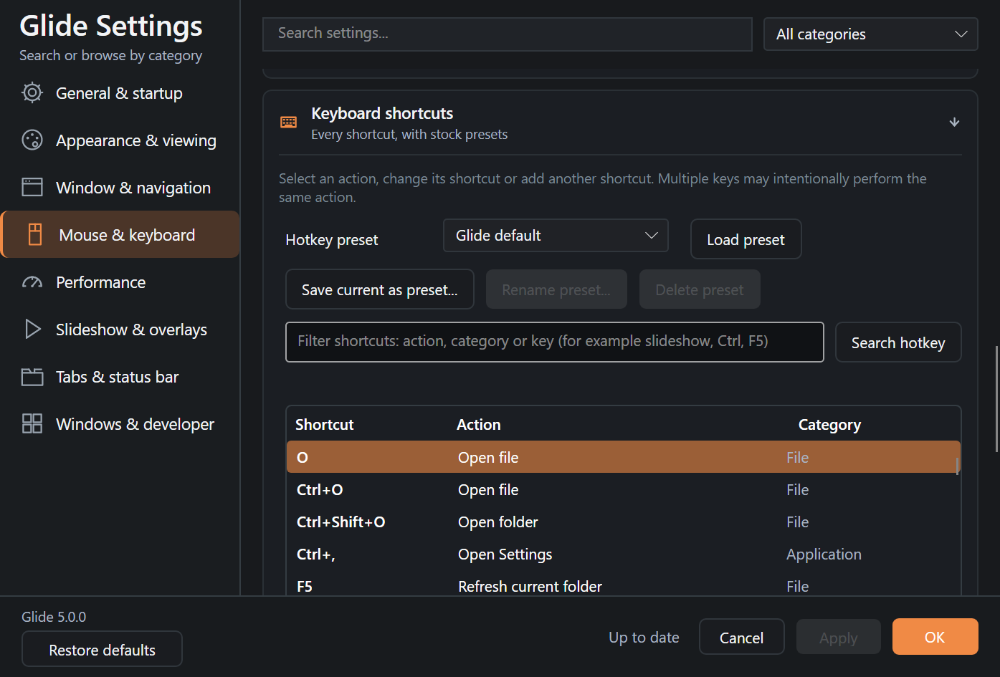
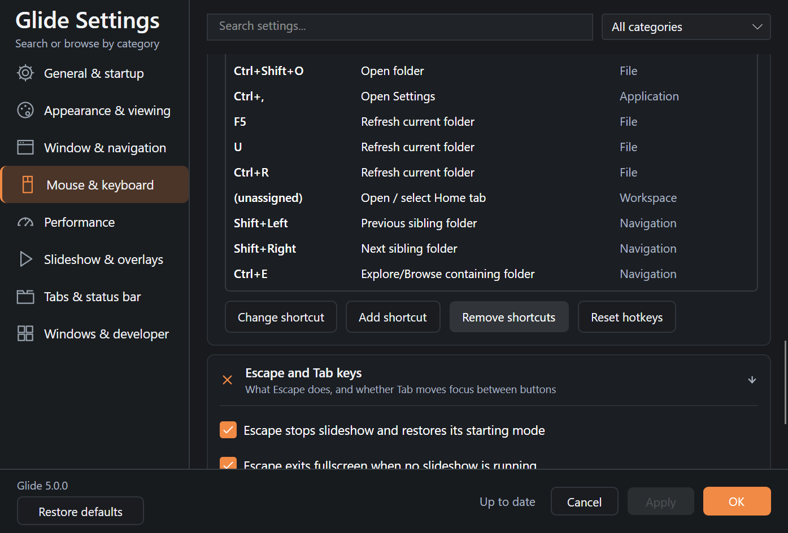
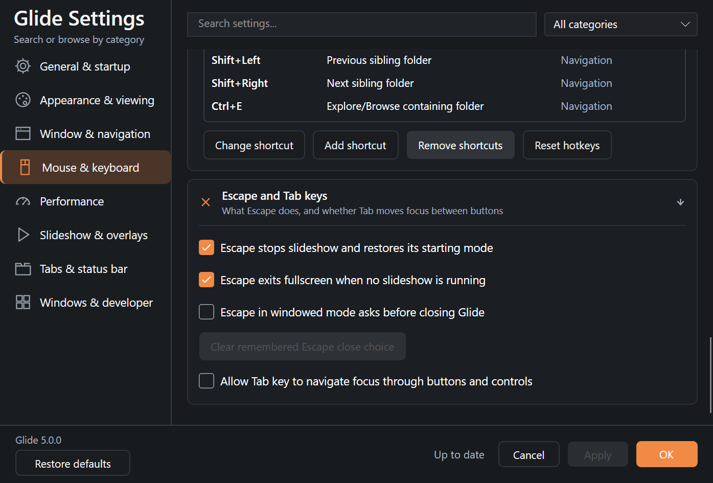

### Settings

Settings is eight pages (General & startup, Appearance & viewing, Window & navigation, Mouse & keyboard, Performance, Slideshow & overlays, Tabs & status bar, Windows & developer) holding 40 collapsible cards. Cards start collapsed, open with a click or the keyboard, remember their state while the window is open and show an *N changed* badge when something differs from the default. Search covers titles, descriptions and aliases, says where each result lives (*Page > Card*) and *Open* switches to the page, opens the card, scrolls to the setting and highlights it; every setting is discoverable through search. The window opens at 930 x 630 (minimum 720 x 480), works at narrow widths, remembers its size, position and page scroll positions, and *Restore defaults* resets only the options (the same as Reset Glide's *All settings*: hotkeys and gestures, window sizes and positions, remembered folders and startup entries are kept); the *Reset Glide* button next to it opens the Reset Glide card for everything else. At the end of Windows & developer, **Reset Glide** wipes exactly what you tick: settings, hotkeys and gestures, profiles, window positions, recent files, the last session, caches and Glide's own per-user registry entries, after a confirmation that lists everything, with a settings backup to `Documents\Glide backups` ticked by default. It never touches the install folder, `HKEY_LOCAL_MACHINE`, your pictures or other programs. Settings can also be saved as named profiles and exported as JSON; imports keep this PC's external programs and drop network folders. **Back up and restore** (Windows & developer, directly above Reset Glide) writes the items you tick to one `.glidebackup` file, which you can import on this or another PC after reviewing what it holds.

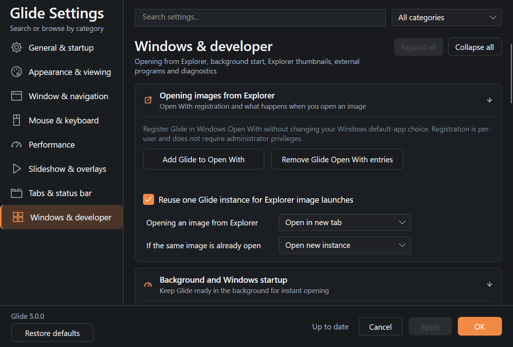
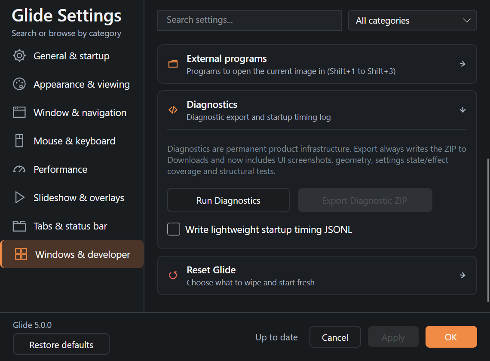
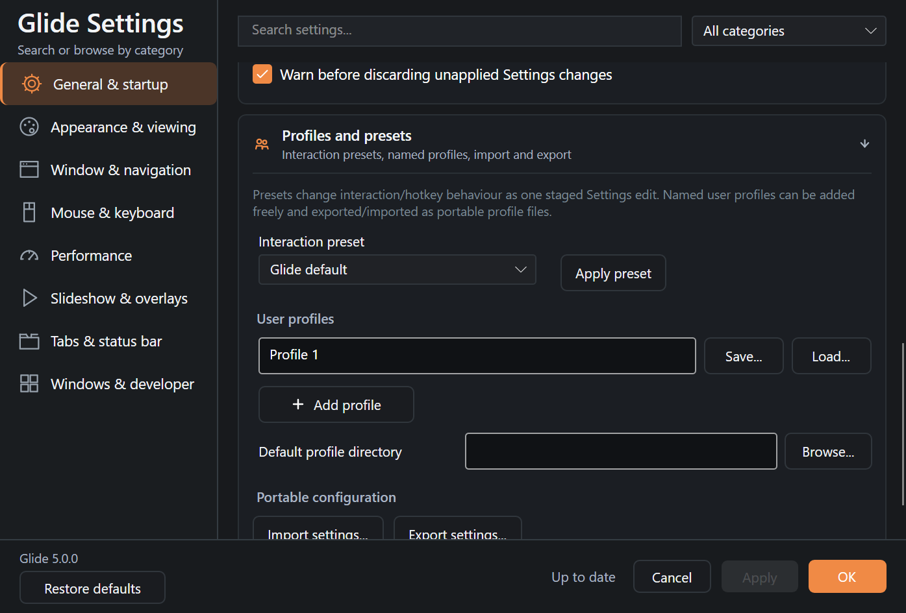

### Slideshow

A slideshow with an interval in milliseconds, forward or backward order, shuffle, looping, continuing across folders, optional fullscreen on start, pausing when Glide is not the active window and a playing indicator. Clicking the picture can pause, step, stop or do nothing, and the slideshow area of the gesture panel has its own rows for left, right and middle click and the wheel. `S` or `Shift+A` starts and pauses it; `Space` pauses while it runs. *Honest limit:* the hotkey list shows `Space` as a fixed key while a slideshow is running.

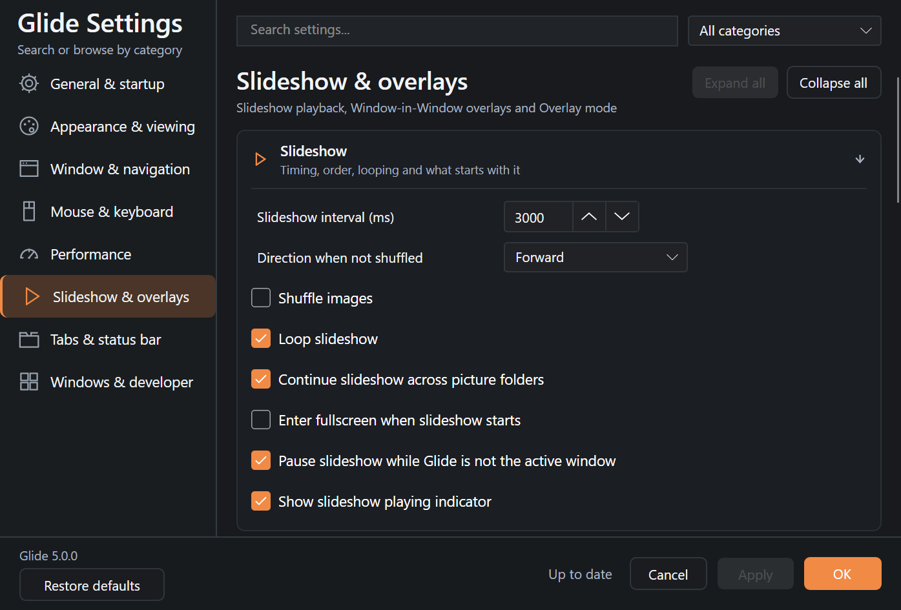

### Window-in-Window overlays

Pin reference images, comparison art or videos above the picture as independent, transparent overlays with their own zoom, pan, opacity and rotation, add them with `Shift+O`, save and load whole layouts (`Ctrl+Shift+S` / `Ctrl+Shift+L`), and let them restore on the next launch. Overlays can drift around a region you draw, avoiding each other; videos play in an overlay with transport, volume, loop and next-video controls using only the codecs Windows already has; if one is missing, Glide tells you exactly which (for example *This video uses the VP9 codec, which isn't installed on this PC.*) and leaves installing it to you. Overlay mode turns the whole app into a borderless transparent floating window. *Honest limit:* videos stay inside overlays; they never enter image navigation.

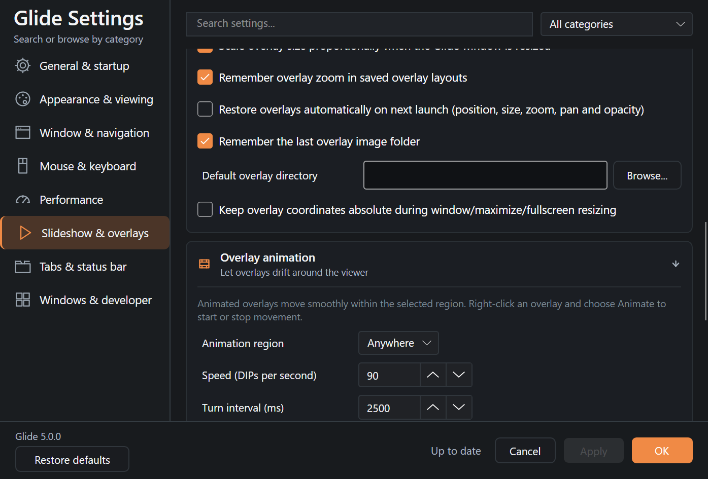

### Animated GIFs

GIFs play in the viewer; `P` pauses and plays, and `,` / `.` step to the previous or next frame (stepping pauses first and wraps around). The controls also appear in the right-click menu and on the status bar, only while a GIF is open, and every one is rebindable. Frames stream straight into their bitmaps, so peak memory halves and a 1080p animation of 60 frames plays where it used to stay still. *Honest limits:* a frame larger than both the canvas and 1 MP is skipped and an animation plays at most its first 10,000 frames, which stops malformed files from exhausting memory; there is no 5.0 screenshot of the GIF controls.

### Print window

`Ctrl+P` prints the original, full-resolution image, never a screenshot of the viewport, through a Glide-native window with a live preview: printer and native Properties, paper size and source, orientation, copies, colour or grayscale, Best fit / Fill page / Actual size (embedded DPI, with a 96 DPI fallback) / Custom scale / Stretch, nine alignments and four margins in your locale's units. In 5.0 the preview stopped waiting for the printer: Portrait / Landscape and every other layout option update instantly, the printer's capabilities are read once in the background, a second Print opens in 35-61 ms, and a 50 MP grayscale preview takes about 11 ms. Preview and print share one layout engine, and a test proves they match for every orientation, scaling mode and alignment. The window remembers its size, position and your layout. *Honest limit:* the first printer-driver read per printer per session is the driver's, not Glide's (about half a second locally, seconds over Remote Desktop). The capture below is from an earlier build; the layout is unchanged.

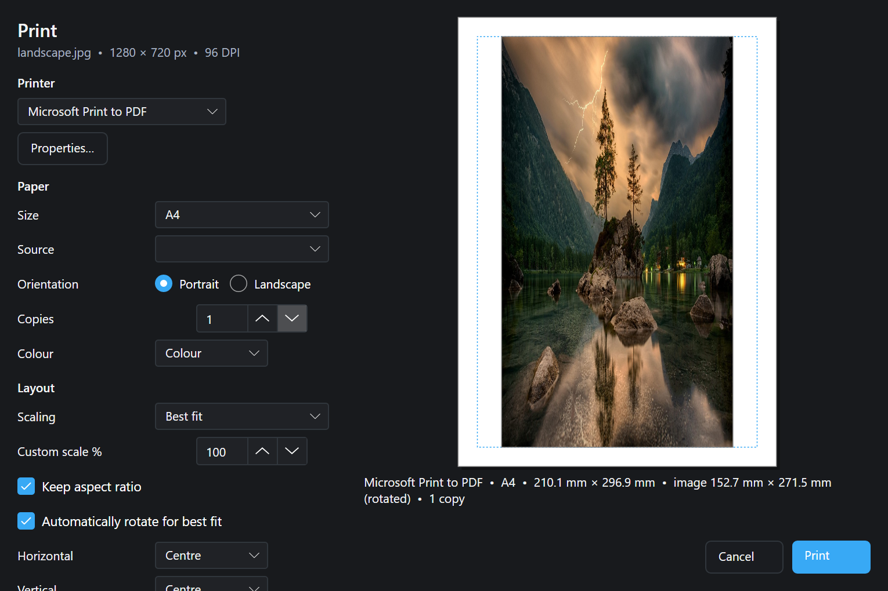

See [docs/print-research.md](docs/print-research.md) for the reference-behaviour study.

### Explorer thumbnails and Windows integration

A small native provider draws real thumbnails in Windows Explorer for every format Glide decodes (it runs in Explorer's isolated thumbnail host and never loads Glide's UI; the newer formats are drawn by two small hash-checked native decoder libraries in the `codecs` folder). The *Fast*, *Balanced* and *High* quality presets, *Maximum source decode size* and *Prefer embedded previews* now genuinely change how thumbnails are made (apply them, then *Refresh thumbnails* for ones Windows already cached), and rotated photos, small camera previews and GIFs come out right. Glide registers itself in Open With for every supported format (per machine by the installer, per user for portable copies). Since 5.0.4 it becomes the default viewer for file types no other app owns; for types another app owns, Setup and the Settings button *Make Glide the default viewer…* open Windows' Default apps page for Glide, and Glide never writes Windows' protected default-app choice. Removing it from Open With sticks. Three external programs (Photoshop, GIMP, Paint.NET ...) sit on `Shift+1` / `2` / `3` and in an Explorer tab they open the image you selected. See [docs/explorer-thumbnails.md](docs/explorer-thumbnails.md).

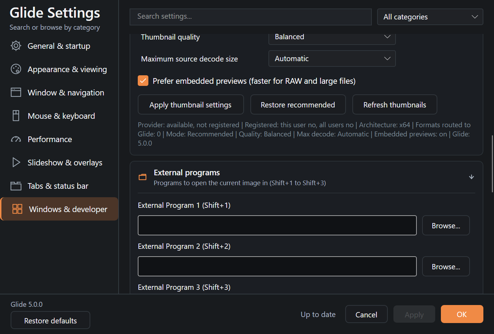

### Format support

Glide recognises and routes 196 filename extensions, and since 5.0.4 about 112 of them decode on a clean Windows install with nothing else installed. The protected fast path covers JPEG, PNG, BMP, GIF, TIFF, WebP and ICO; built-in decoders cover SVG / SVGZ (rendered at exactly the resolution needed), the legacy raster family TGA, PCX, PNM / PAM / PFM, QOI, Radiance HDR, WBMP, XBM, XPM and SGI, camera RAW (the full-size preview embedded in 40 RAW formats), OpenEXR, DICOM, NIfTI, FITS, OpenRaster, Krita, GIMP XCF, Paint.NET (full layered decode) and GPU textures (KTX, KTX2, PVR, ASTC); Photoshop PSD, PSB and PDD show their stored flattened composite, including ZIP-compressed files (layers are not re-composited). A bundled 4.9 MB codec module adds AVIF, HEIC / HEIF, JPEG XL and JPEG 2000 (and writes JPEG 2000 and WebP), loaded only when one of those files is opened or saved. Everything else goes through Windows WIC, a genuine Windows Shell preview or a verified optional codec provider, and when nothing can decode a file Glide names the suffix instead of failing silently. *Honest limits:* a PSD saved without Maximize Compatibility can show an out-of-date composite. **Save As** (5.0.4) writes about 30 formats: JPEG, PNG, WebP, GIF, BMP, TIFF, JPEG XR, JPEG 2000, QOI, TGA, ICO, DDS, KTX, OpenEXR, Radiance HDR, PFM, PSD / PSB, OpenRaster, SGI, PNM / PAM, XPM, XBM and WBMP, plus HEIC, AVIF and JPEG XL when a Windows codec extension with an encoder is installed; the list shows only what this PC can write, keeps the file name's extension in step with the chosen type, and carries EXIF / XMP / colour profile over (Orientation reset) for JPEG, PNG, WebP, TIFF and JPEG XR. Not written: Krita, animation, RAW, vector. See [docs/format-coverage.md](docs/format-coverage.md).

### Performance and multi-threading

Glide is built around a staged pipeline: a decoder-scaled first frame as soon as possible, then refinement to full resolution while you look at it, with prefetch ahead of and behind your position. 5.0 reworked it: PNG, TIFF, BMP, GIF and ICO decode at full resolution straight away when they fit the budget and refinement is skipped or goes directly to the final frame; a new native entry point decodes into the bitmap you see (half the peak memory); prefetch no longer re-decodes neighbours it already has and decodes the nearest ones in parallel (1 lane on constrained PCs, 2 on mainstream, up to 6 on high-end) while cancelling stale work when you jump; every bitmap has a deterministic lifetime; and a free-memory guard protects very large frames. The quality profile (Maximum speed, Balanced, Maximum quality or your own) and the cache budgets are all in Settings, and Speed Boost keeps a warm Glide in the background (a working set of only 3-4 MB) so opening from Explorer is immediate. *Honest limit:* decoding one image is bound by the Windows codecs, which are single-threaded, and opening the Settings window takes about 50-260 ms.

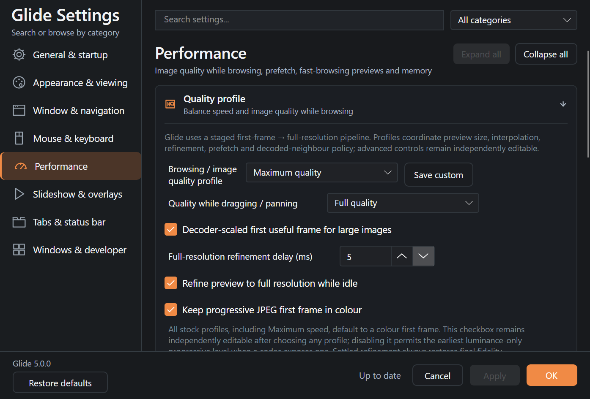
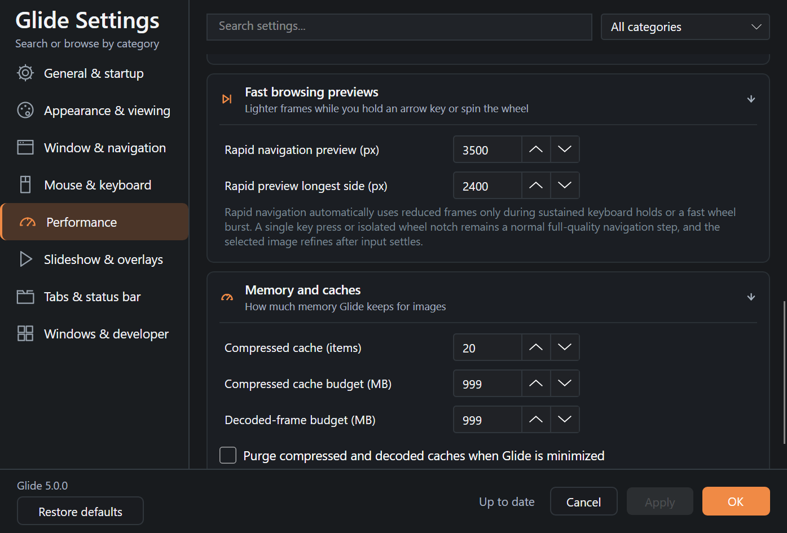

### Security hardening

5.0.1 adds the fixes of an external code audit: a cross-drive folder move removes only the originals Glide copied and verified (anything that arrived or changed during the move stays and is reported), a multipage or animated image can't be overwritten in place with a single frame. A full security review shaped 5.0.0. SVG files can no longer make Glide contact other computers (linked web, network-share and relative images are dropped before rendering, so your IP address and Windows credentials are never sent); imported profiles keep your external programs and drop network folders and are refused above 16 MB; malformed GIFs, PSDs and very large images are bounded on every decode path; the single-instance hand-off is private to your Windows user; the installer no longer trusts a per-user registry value, starts Glide without administrator rights and locks down custom install folders; Glide no longer loads libraries from the folder of the image being opened; pasting into the Explorer tab ignores relative paths; and both native components are built with Control Flow Guard, CET and extra compiler checks. The audit found nothing in the native decoders' size checks, the IPC parser, file associations or metadata parsing.

### Update check

Once a day (about 20 seconds after Glide starts, and again every 24 hours while it keeps running in the background) Glide sends one small request to `api.github.com` asking for the latest release of the Glide repository. Only a plain HTTPS request is made: no personal data, no cookies, no account, no identifier beyond the generic name `Glide-UpdateCheck`; the answer is capped at 256 KB and a failed or offline check is silent and retried a few hours later. When a newer stable version exists Glide shows a small window, *A new version of Glide is available*, with *Not now* and *View on GitHub*. **View on GitHub only opens the release page in your browser: Glide never downloads, installs or runs anything by itself.** Tick *Don't remind me again* (or *Don't remind me about updates* in Settings) to turn the window off for good; the Updates card still shows that a new version exists. The prompt waits while you are in fullscreen, a slideshow, another dialog or a text box, and shows at most once a day per version. *Settings > General & startup > Updates* has *Check for updates once a day* (turn it off to stop all update requests), a status line and *Check now*, which also works with the daily check off; the hotkey action *Check for updates now* (no default key) does the same from anywhere.

### Accessibility and privacy

Glide has no telemetry. Its only network requests are the once-a-day update check described above (one small request to GitHub for the latest release, off with one switch in Settings > General & startup > Updates; Glide never downloads or installs the update itself). Glide downloads no codecs: videos play with what Windows has. Diagnostic exports and traces happen only when you ask for them in Settings > Windows & developer (a normal install writes nothing to your Downloads folder; local crash logs are written only if Glide crashes). Everything works from the keyboard, with rebindable shortcuts, a *Tab key button navigation* option, and themes with your own accent, glow and background colours.

### Quality of life

Live folder refresh adds, removes and renames images in navigation as files arrive (partial downloads are ignored until they finish); next / previous use Explorer's natural order with six sort choices and can continue into sibling and parent folders; `Ctrl+S` saves in place after a confirmation (layered, HDR, icon and texture files open Save as instead) and `Ctrl+Alt+S` is Save as, which converts to any of about 30 formats this PC can write through a temporary file, so a failed save can never damage the original; Save, rename and delete (to the Recycle Bin) are a keystroke away; the *Escape and Tab keys* card (Settings > Mouse & keyboard) decides what Escape does; and the Home list, closed-tab history and window positions are kept the way you want.

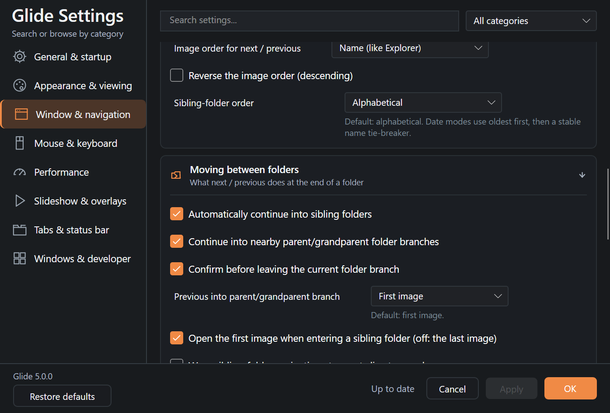

---

## Default shortcuts

Every shortcut can be changed in Settings > Mouse & keyboard > Keyboard shortcuts. This is the *Glide default* preset; the other presets differ.

| Action | Shortcut |
|---|---|
| Next / previous image | `Space`, `Right`, `Page Down` / `Left`, `Page Up` |
| Back / forward (tab history) | `Alt+Left` / `Shift+Backspace`, `Alt+Right` (mouse back / forward buttons) |
| Back, or Previous image | `Backspace`: Back through the tab history when there is a step back, otherwise the previous image in an image tab, otherwise nothing (never while typing) |
| Up one folder (Explorer) | `Alt+Up` |
| First / last image | `Home` / `End` (also `Ctrl+Home` / `Ctrl+End`) |
| Previous / next sibling folder | `Shift+Left` / `Shift+Right` |
| Toggle fullscreen | `F`, `F11`, `Enter` |
| Zoom in / out | `+` or `=` / `-` (by the *Viewport zoom step*, default 15 %) |
| Fit image / Fit to window / Fit width / Fit height / Actual size | `Shift+W` / `4` / `2` / `1` / `3` or `Ctrl+H` (follow *Fit control scope*) |
| Rotate left / right, flip horizontal / vertical | `L` / `R`, `H` / `V` |
| Animated GIF: pause / play, previous / next frame | `P`, `,` / `.` |
| Start / pause slideshow, image information | `S` or `Shift+A`, `I` |
| Open file / open folder / Settings | `O` or `Ctrl+O` / `Ctrl+Shift+O` / `Ctrl+,` |
| Refresh folder | `F5`, `U`, `Ctrl+R` |
| New tab / close tab / restore closed tab / duplicate tab | `Ctrl+T` / `Ctrl+W` or `Ctrl+F4` / `Ctrl+Shift+T` / `Ctrl+Shift+K` |
| Next / previous tab, select tab 1-8, last tab | `Ctrl+Tab` or `Ctrl+Page Down` / `Ctrl+Shift+Tab` or `Ctrl+Page Up`, `Ctrl+1` to `Ctrl+8`, `Ctrl+9` |
| New window with this picture / duplicate window | `Ctrl+N` / `Ctrl+Shift+N` |
| Close Glide window | `Ctrl+Shift+W` |
| **Show / hide status bar** | **`Ctrl+Shift+B`** |
| **Show folder in Explorer** (*Explore/Browse containing folder*) | **`Ctrl+E`** |
| Copy image / rename / delete (Recycle Bin) | `Ctrl+C` / `F2` or `F6` / `Delete` |
| Print / Save / Save As | `Ctrl+P` / `Ctrl+S` / `Ctrl+Alt+S` |
| Open in external program 1 / 2 / 3 | `Shift+1` / `Shift+2` / `Shift+3` |
| Add overlay / save overlay layout / load overlay layout | `Shift+O` / `Ctrl+Shift+S` / `Ctrl+Shift+L` |
| Clear selection | `Esc` |

Unassigned by default (assign them yourself): Exit Glide, Jump 10 images, Zoom to 200 %, New Explorer tab, Maximize / restore, Minimize, the *Toggle:* / *Cycle:* setting actions and the rest of the new commands. *Exit Glide* quits the whole program (tray icon and Speed Boost included); `Ctrl+Shift+W` closes only one window.

---

## Recognized and routed formats

Glide recognizes and routes **196 filename extensions**:

<strong>Expand full list of 196 recognized/routed extensions</strong>

.jpg, .jpeg, .jpe, .jfif, .jif, .jfi, .pjpeg, .pjpg, .png, .apng, .mng, .jng, .bmp, .dib, .rle, .wbmp, .tif, .tiff, .btf, .gif, .ico, .cur, .ani, .icns, .webp, .heic, .heif, .heics, .heifs, .hif, .avif, .avifs, .svg, .svgz, .jxr, .wdp, .hdp, .jp2, .j2k, .j2c, .jpc, .jpx, .jpf, .jpm, .mj2, .jxl, .psd, .psb, .pdd, .xcf, .ora, .kra, .afphoto, .afdesign, .afpub, .clip, .csp, .pdn, .psp, .pspimage, .pxr, .tga, .targa, .icb, .vda, .vst, .dpx, .cin, .sgi, .rgb, .rgba, .bw, .ras, .sun, .iff, .lbm, .ilbm, .img, .pic, .pict, .pct, .pict2, .eps, .epsf, .ai, .pdf, .pnm, .ppm, .pgm, .pbm, .pam, .pfm, .pcx, .qoi, .hdr, .rgbe, .xyze, .exr, .dds, .ff, .fits, .fit, .fts, .fts.gz, .hdr.gz, .xbm, .xpm, .xwd, .cut, .mac, .mpo, .jps, .pns, .dng, .cr2, .cr3, .crw, .nef, .nrw, .arw, .srf, .sr2, .raf, .orf, .ori, .rw2, .rwl, .pef, .ptx, .3fr, .fff, .iiq, .cap, .eip, .mef, .mos, .mrw, .x3f, .erf, .kdc, .dcr, .k25, .bay, .srw, .rwz, .gpr, .mdc, .raw, .r3d, .ari, .cinema, .dcs, .drf, .dsc, .r2d, .rw1, .dcm, .dicom, .ima, .nii, .nii.gz, .mha, .mhd, .nrrd, .ndpi, .svs, .vms, .vmu, .scn, .mrxs, .bif, .czi, .lif, .lsm, .ome.tif, .ome.tiff, .vsi, .ktx, .ktx2, .pvr, .astc, .basis, .tex, .vtf, .wal, .spr, .cdr, .cmx, .cpt, .emf, .wmf, .emz, .wmz, .dwg, .dxf, .skp

**Protected core fast-path suffixes:** .jpg, .jpeg, .jpe, .png, .bmp, .gif, .tif, .tiff, .webp, .ico

**Bundled built-in decoder suffixes (no optional codec required):** .svg, .svgz, .tga, .targa, .icb, .vda, .vst, .pcx, .pnm, .ppm, .pgm, .pbm, .pam, .pfm, .qoi, .hdr, .rgbe, .hdr.gz, .wbmp, .xbm, .xpm, .sgi, .rgb, .rgba, .bw, .psd, .psb, .pdd, .exr, .dcm, .dicom, .ima, .nii, .nii.gz, .fits, .fit, .fts, .fts.gz, .ora, .kra, .xcf, .pdn, .ktx, .ktx2, .pvr, .astc, and camera RAW .dng, .cr2, .cr3, .crw, .nef, .nrw, .arw, .srf, .sr2, .raf, .orf, .ori, .rw2, .rwl, .pef, .ptx, .3fr, .fff, .iiq, .cap, .eip, .mef, .mos, .mrw, .x3f, .erf, .kdc, .dcr, .k25, .bay, .srw, .rwz, .gpr, .mdc, .raw, .dcs, .drf, .dsc, .r2d, .rw1

**Bundled codec module (codecs\glidecodecs.dll):** .avif, .avifs, .heic, .heif, .heics, .heifs, .hif, .jxl, .jp2, .j2k, .j2c, .jpc, .jpx, .jpf, .jpm, .mj2

Whether a recognised suffix actually opens depends on the route (built-in decoder, Windows WIC, Windows Shell preview or an optional codec provider); see [docs/format-coverage.md](docs/format-coverage.md) for the full route map and a comparison with IrfanView.

---

## System requirements

Windows x64. No .NET runtime is required (the app is self-contained and NativeAOT-compiled with .NET 10 from 5.0.1; 5.0.0 and earlier were built with .NET 8). Windows 10 version 1607 or later. The installer needs administrator rights; the portable build does not.

## Building from source

On Windows, run `build.cmd` (or `build.cmd fast --no-pause`). Release builds produce `Glide-<version>-Portable.zip`, `dist-installer\Glide Setup.exe` and the compact `Glide-Zero-Context-Handover.zip`; on GitHub the installer is published as `Glide.Setup.exe` together with `Glide.Setup.sha256` and the portable archive (for 5.0.4: `Glide-5.0.4-Portable.zip`). Building needs the .NET 10 SDK (x64) and the Visual Studio 2022/2026 C++ tools (see [docs/NET10-MIGRATION-PLAN.md](docs/NET10-MIGRATION-PLAN.md)). Scripts live in `tools/`; the performance benchmark harness is `tools/perf`. Three test projects cover Core, Input and Explorer; settings and actions have static audits (`python tools/audit-settings-search.py`, `python tools/audit-action-registry.py`).

## Documentation

| Document | What it is |
|---|---|
| [CHANGELOG.md](CHANGELOG.md) | Every change in every release |
| [docs/releases/](docs/releases/) | Release notes per version, the 5.0.0 [community feedback map](docs/releases/5.0.0-community-feedback.md) and the publish checklist |
| [docs/ACTIONS-AND-HOTKEYS.md](docs/ACTIONS-AND-HOTKEYS.md) | The master action registry: hotkeys, gestures, menus, buttons |
| [docs/NAVIGATION-HISTORY.md](docs/NAVIGATION-HISTORY.md) | Back / Forward design and rules |
| [docs/format-coverage.md](docs/format-coverage.md) | Which format opens through which route |
| [docs/explorer-thumbnails.md](docs/explorer-thumbnails.md) | The Windows Explorer thumbnail provider |
| [docs/print-research.md](docs/print-research.md) | Print window reference study |
| [docs/code-signing.md](docs/code-signing.md) | Signing releases |
| [docs/GLIDE_MANIFESTO_AND_HANDOFF.md](docs/GLIDE_MANIFESTO_AND_HANDOFF.md) | Architecture and handoff for contributors |
| [docs/README.md](docs/README.md) | Index of everything in `docs/` |

## Earlier releases

* **4.7.1 / 4.7.0:** animated GIFs, a *Fit to window* mode (key `4`), tabs with Ctrl+Tab in recent order, a simpler Home page, status bar position and a corner expand button, right button + wheel, Speed Boost tray icon choices, and the Always on top menu.
* **4.6.0:** video overlays (Windows codecs first, optional FFmpeg, removed again in 5.0.4), Settings reorganised from 14 categories into eight, an adaptive status bar and grouped menus, image sort order and Explorer-style natural sorting.
* **4.5.0:** Photoshop PSD / PSB / PDD files open and get thumbnails. **4.4.0:** live folder refresh, Save and Save As, and an Explorer thumbnail security fix.
* **4.3 and 4.2:** Windows Explorer thumbnails, taskbar and maximize fixes, native SVG and legacy raster decoders, a defined route for every recognised extension, automatic Open With, and complete image printing.

See the [changelog](CHANGELOG.md) and the [release notes](docs/releases/) for everything.

## License

Glide is free software, licensed under the [GNU General Public License v3.0 or later](LICENSE) (GPL-3.0-or-later). The complete source code is available in the GitHub repository at https://github.com/cobhc95/Glide. Bundled third-party components keep their own licences; see [THIRD-PARTY-NOTICES.md](THIRD-PARTY-NOTICES.md). An [additional permission under GPLv3 section 7](licenses/GLIDE-ADDITIONAL-PERMISSION.txt) allows combining Glide with the Ms-PL-licensed SVG libraries it uses. Contributions are welcome under the terms in [CONTRIBUTING.md](CONTRIBUTING.md).
