# Glide Image Viewer

> **Glide 5.1.6:** [download](https://github.com/cobhc95/Glide/releases/latest) · reopening a closed tab restores it in place with its full history; plus 5.1.5's transparent Explorer thumbnails and installer thumbnail choice, on top of 5.1's instant tab switching, faster large-photo browsing with less memory, live Explorer tabs and browser-style tabs. [Release notes](docs/releases/release-notes-5.1.6.md) · [changelog](CHANGELOG.md)

## Fast. Multi-tabbed. Multi-window. Highly customizable.

**Glide is a Windows image viewer built to feel instant**: tabs and multiple windows, a built-in Explorer tab, 196 recognised file extensions (about 112 open on a clean Windows install), Save As to about 30 formats, printing, overlays, a hotkey or gesture for almost everything, and Explorer thumbnails. No telemetry, no .NET runtime to install.

[Download](#download-and-install) · [Performance](#performance) · [Feature tour](#feature-tour) · [Shortcuts](#default-shortcuts) · [Formats](#formats) · [Build](#building-from-source) · [Docs](#documentation)

## Download and install

Windows 10 1607 or later, x64. From the [latest release](https://github.com/cobhc95/Glide/releases/latest):

* **`Glide.Setup.exe`**: installer (administrator rights; adds Open With and Explorer thumbnails).
* **`Glide-5.1.6-Portable.zip`**: extract anywhere and run `Glide.exe`.
* **`Glide.Setup.sha256`**: checksum (`certutil -hashfile Glide.Setup.exe SHA256`).

Upgrades keep your settings, key bindings and title bar.

## Performance

Glide shows a sharp, screen-sized view as early as possible, prepares the pictures around it at screen size, and decodes the picture you stop on at full resolution straight away.

**Measured in 5.1** (vs 5.0.7; synthetic or generic test files; [release notes](docs/releases/release-notes-5.1.1.md#speed-results)):

* **Lower memory**: neighbours are kept at screen size, pictures you leave shrink to screen size, and minimising frees all but the current picture.
* **Progressive JPEGs**: preloading a 30 MP picture 630 → 300 ms.
* **Tab switching**: back to an Explorer tab 65–101 → 13–42 ms, back to a picture tab 51–107 → 16–19 ms.
* **From 5.0.7**: TIFF about 4x faster, JPEG full decode 1.3–1.8x, camera JPEG previews 225 → 39 ms, JPEG XL / HEIC / JPEG 2000 12–20 % faster ([report](docs/perf/benchmark-report-5.0.7.md)).

**Which engine handles what, and why**

* **JPEG** (`.jpg .jpeg .jpe .jfif` …): camera files with a large embedded (MPF) preview show it first; otherwise WIC gives the first view (progressive files decoded through their final scan) and libjpeg-turbo's reduced-size decode speeds up progressive prefetch. The full picture is decoded by **libjpeg-turbo** (memory-mapped, straight into the bitmap, large baseline files in up to 8 parallel bands), within one level per channel of WIC. CMYK, 12-bit, lossless, arithmetic and anything odd fall back to WIC.
* **TIFF, BMP**: WIC, split into up to 8 parallel bands, each with its own decoder (identical pixels).
* **PNG, GIF, ICO**: WIC, decoded at full resolution straight away when they fit the budget.
* **WebP**: Skia (Windows has no WebP decoder without a Store extension).
* **JPEG XL, AVIF, HEIC / HEIF, JPEG 2000**: the bundled `codecs\glidecodecs.dll` (libjxl, dav1d, libde265, OpenJPEG), built for speed and using every core; loaded only when needed.
* **Camera RAW** (40 formats): the largest embedded preview anywhere in the file, including Kodak DCR (compression 65000) and Epson ERF maker-note previews.
* **SVG, PSD, EXR, DICOM, legacy rasters and more**: Glide's own decoders; the rest go through WIC, the Windows Shell or an optional codec.

**Prefetching and caching**

* **Predictive prefetch** decodes the next and previous images off the UI thread (*prefetch depth* 1–30 each way, default 15), nearest first, in 1–6 parallel lanes by PC class, cancelling stale work when you jump.
* **Decoded and compressed caches** keep finished bitmaps and raw neighbour file bytes (budgets in Settings > Performance).
* **Speed Boost** keeps a warm Glide in the background (3–4 MB working set); opening from Explorer shows the window at once and the picture fills in.

## Feature tour

### Viewer

Fit to window, width or height, or 100 %; zoom at the pointer, zoom to a dragged region, pan, rotate and flip. Images up to 512 MP open at full resolution behind a free-memory check. Fullscreen hides the cursor. Animated GIFs play with pause and frame stepping (`P`, `,` `.`). A text overlay shows index, name or any token you choose. Tooltip delays are set per area (Settings window, main interface, Overlay, Explorer items).

| Appearance | Tooltips |
|---|---|
| 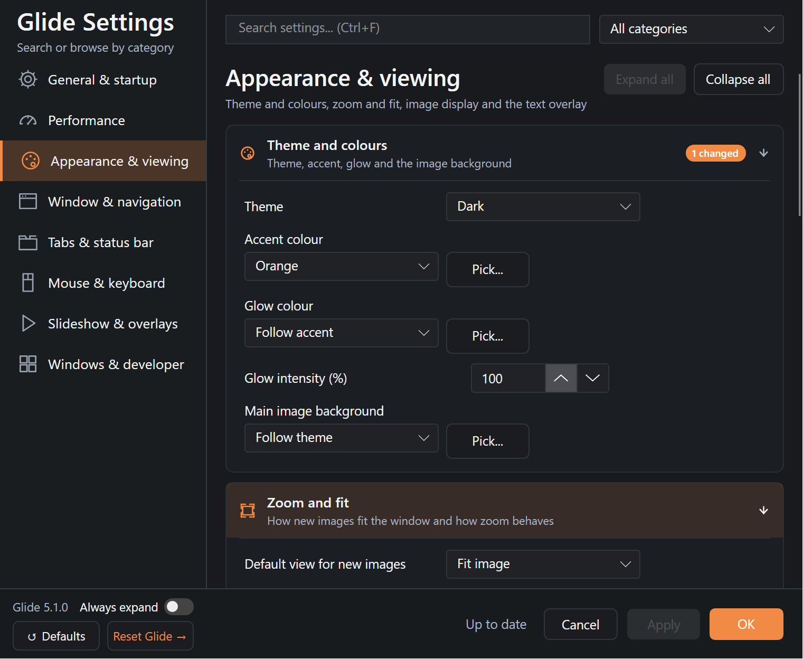 | 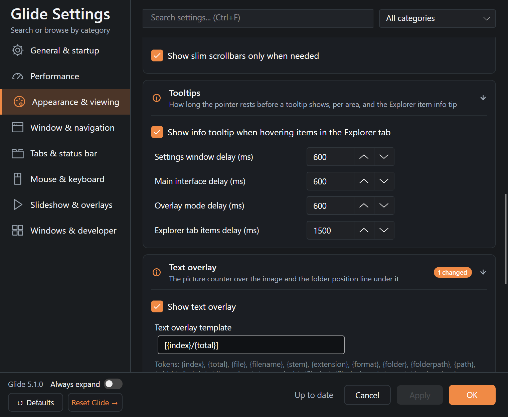 |

### Moving through folders

Next / Previous use Explorer's natural order with six sorts, and live folder refresh picks up new files. **When the last image is reached** decides what happens at the end of a folder: do nothing, loop, move to the next folder (also in a new tab), go back, show Home, or **Ask me each time** (default): a small card with numbered choices and *Remember this choice*. The **Loop this folder** status-bar button loops the current tab only. Bouncy laptop keys no longer skip pictures .

| Ask me each time | The setting |
|---|---|
| 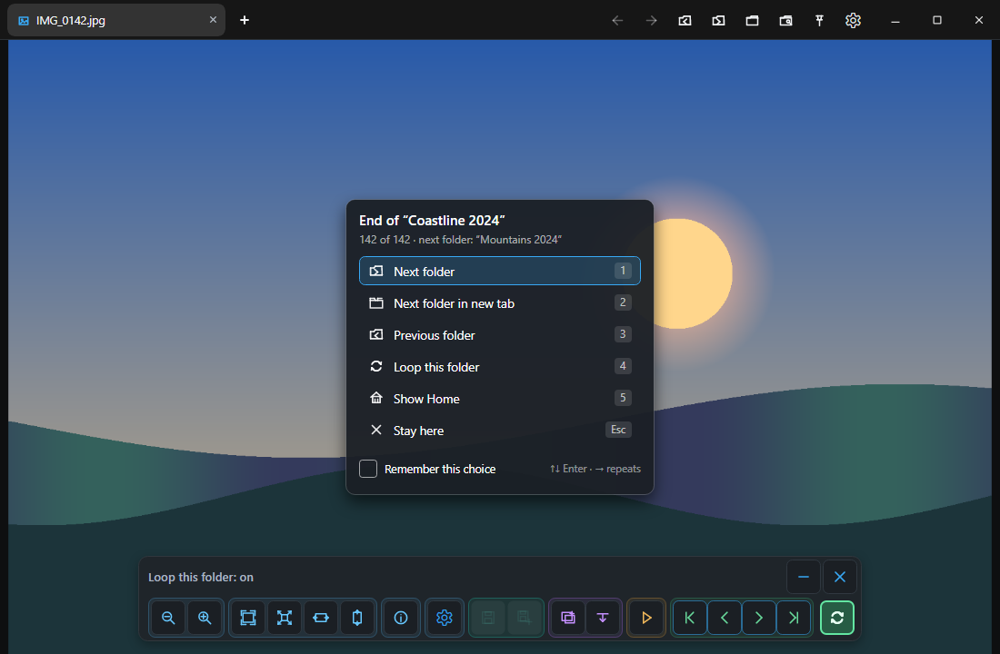 | 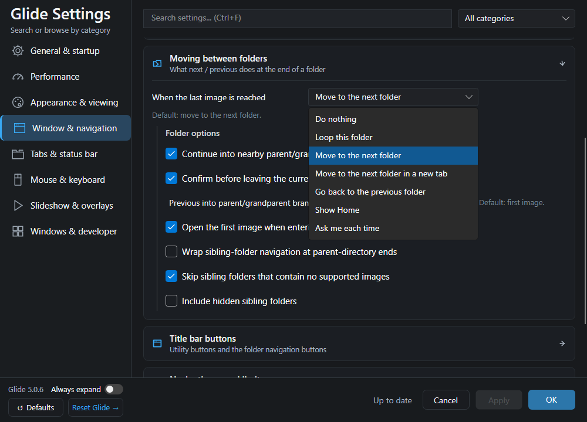 |

### Explorer tab

A folder browser inside a tab: breadcrumb address bar, a resizable drive bar, Thumbnails XL / L / M / S, List and Details, sorting by name, date, type, file size or image width / height / pixels, filter (`Ctrl+F`), click-to-rename, copy / cut / paste through the Windows clipboard, Recycle Bin delete and drag and drop. Changes made in Windows File Explorer or other programs appear within a fraction of a second, updated in place without a reload. Optionally show date, resolution and file size under thumbnails, and keep the address bar above pictures in picture tabs. *Open last session* restores each tab's folder, selection and scroll, even after a crash.

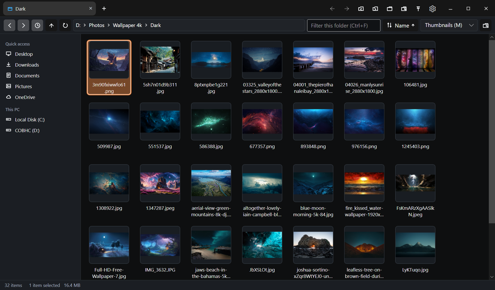

| Compact | Portrait | Landscape |
|---|---|---|
| 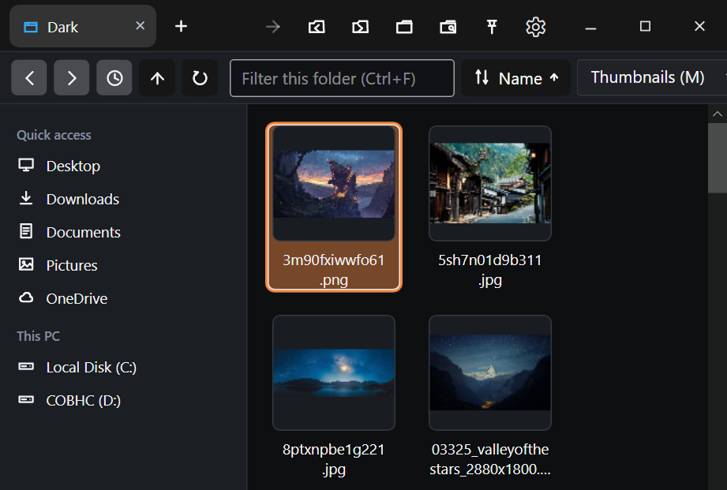 | 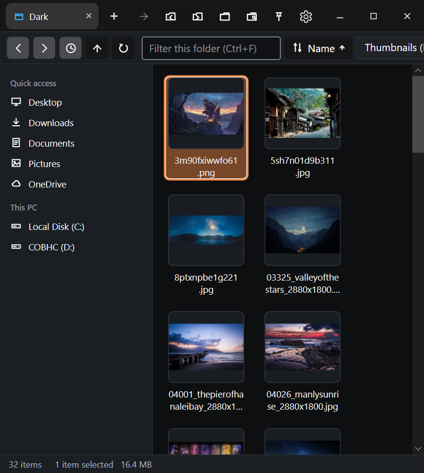 | 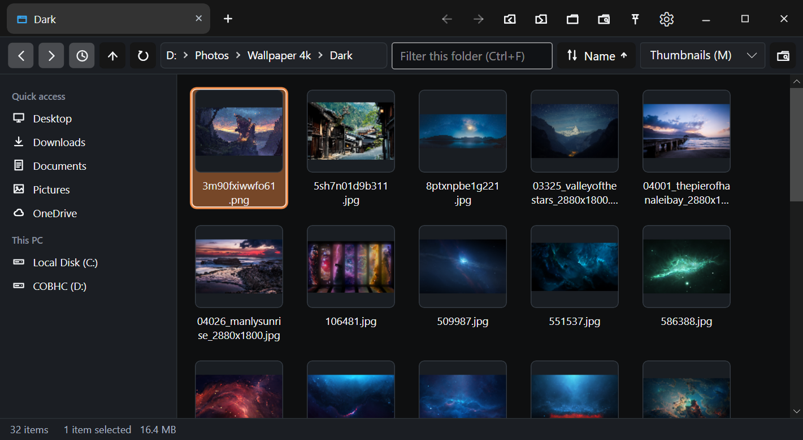 |

| Ultra-wide | Selected tile |
|---|---|
| 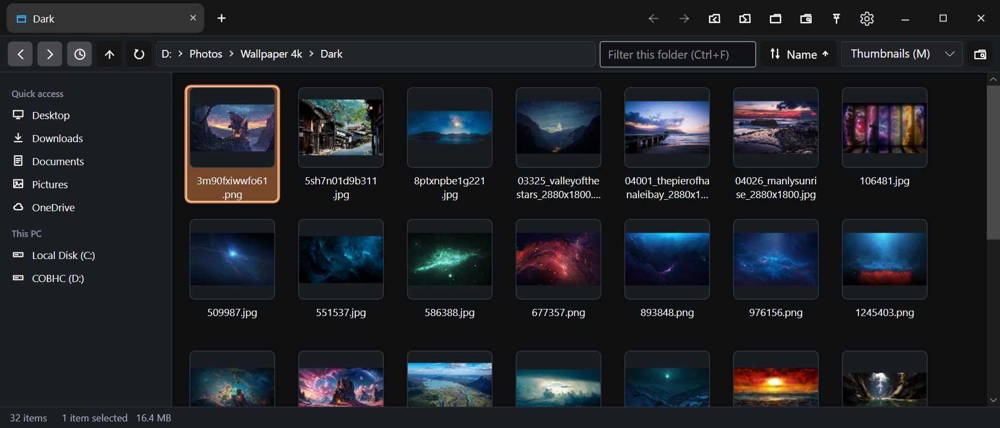 | 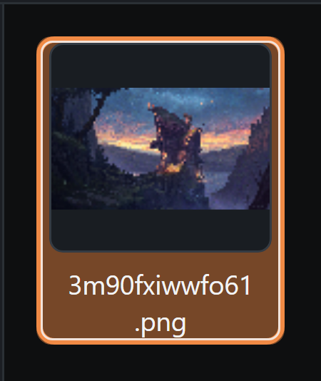 |

### Tabs, windows and history

Drag tabs between windows, restore closed tabs (`Ctrl+Shift+T`), duplicate, and `Ctrl+Tab` in tab or recent order. Switching back to a recent tab is instant: its picture, zoom or folder view is kept. Hovering a tab previews it (resize with Ctrl+wheel). Like a browser, middle-click opens in a background tab at the end and `Ctrl+T` adds a tab at the far right; you choose where new tabs open, a key to flip that, and which tab activates after closing one (including first, last or a Home / Explorer tab). Every tab has browser-style **Back / Forward** (100 steps; `Alt+Left` / `Alt+Right`, title-bar buttons, and the mouse side buttons if you bind them). See [NAVIGATION-HISTORY.md](docs/NAVIGATION-HISTORY.md).

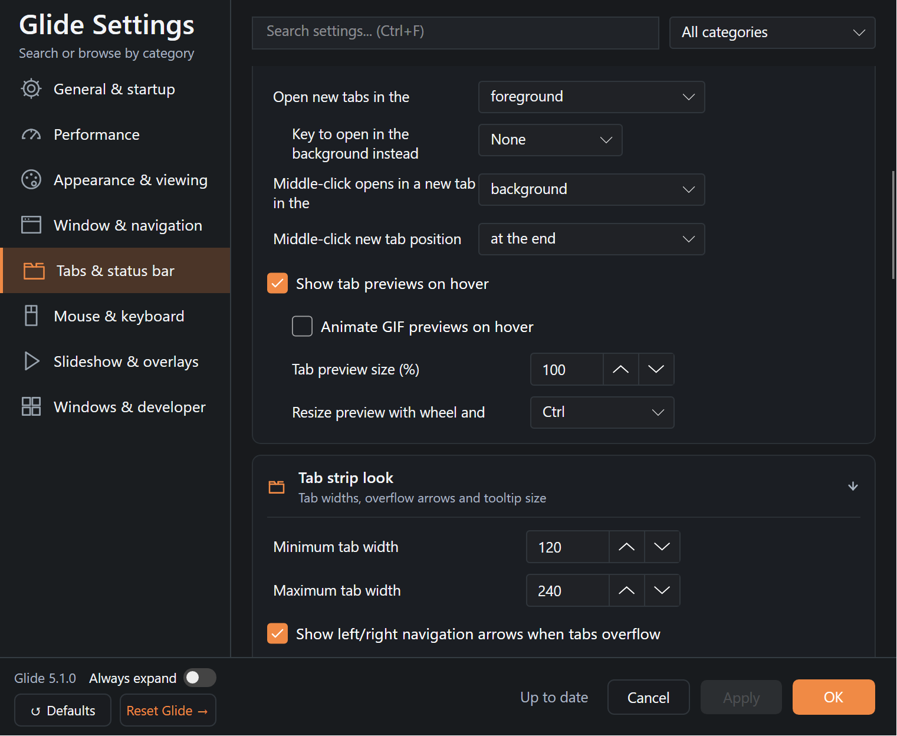

### Status bar and title bar

The status bar stacks file info above its buttons, reflows to the window width, can auto-hide, and can reserve space when fitting. Title-bar buttons are customisable and hide gracefully when the window narrows.

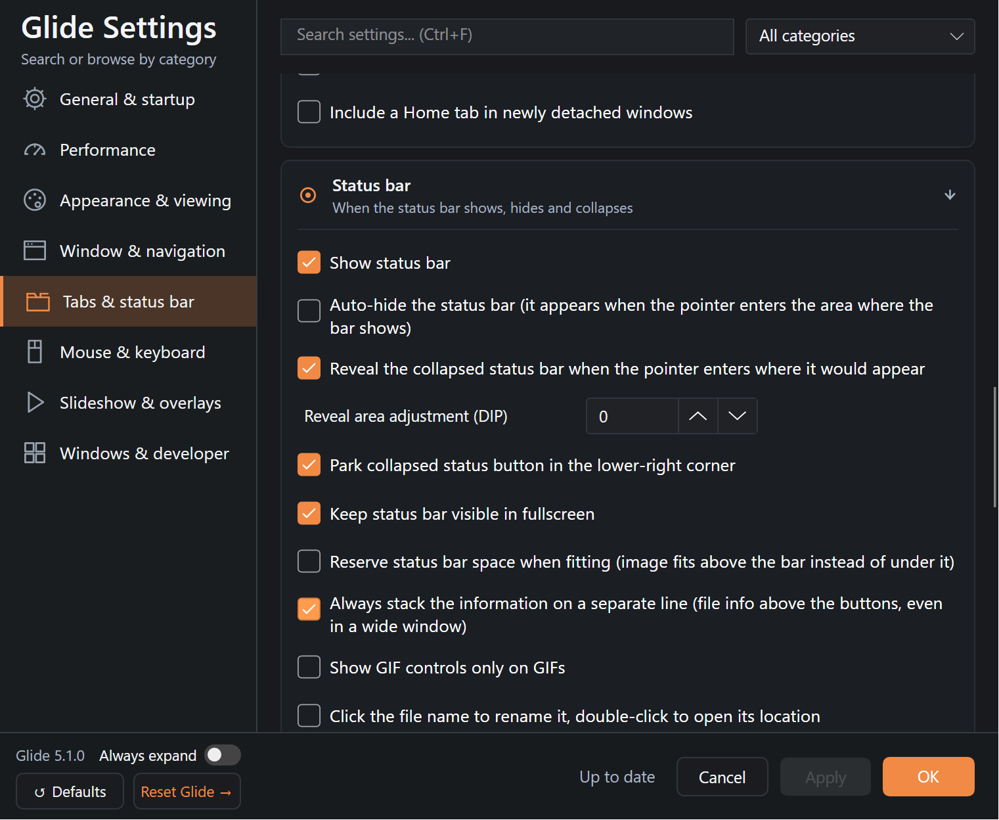

### Hotkeys and mouse gestures

One registry of more than 260 actions sits behind every key, gesture, button and menu, and 132 on/off and choice settings can be bound as *Toggle:* / *Cycle:* actions. Presets for Glide, Windows Photos, IrfanView, nomacs, FastStone and XnView MP; *Search hotkey* tells you what a key does; conflicts are named before you replace them. One gesture panel covers clicks, drags and wheel in 9 areas, with up to 6 custom gestures each. See [ACTIONS-AND-HOTKEYS.md](docs/ACTIONS-AND-HOTKEYS.md).

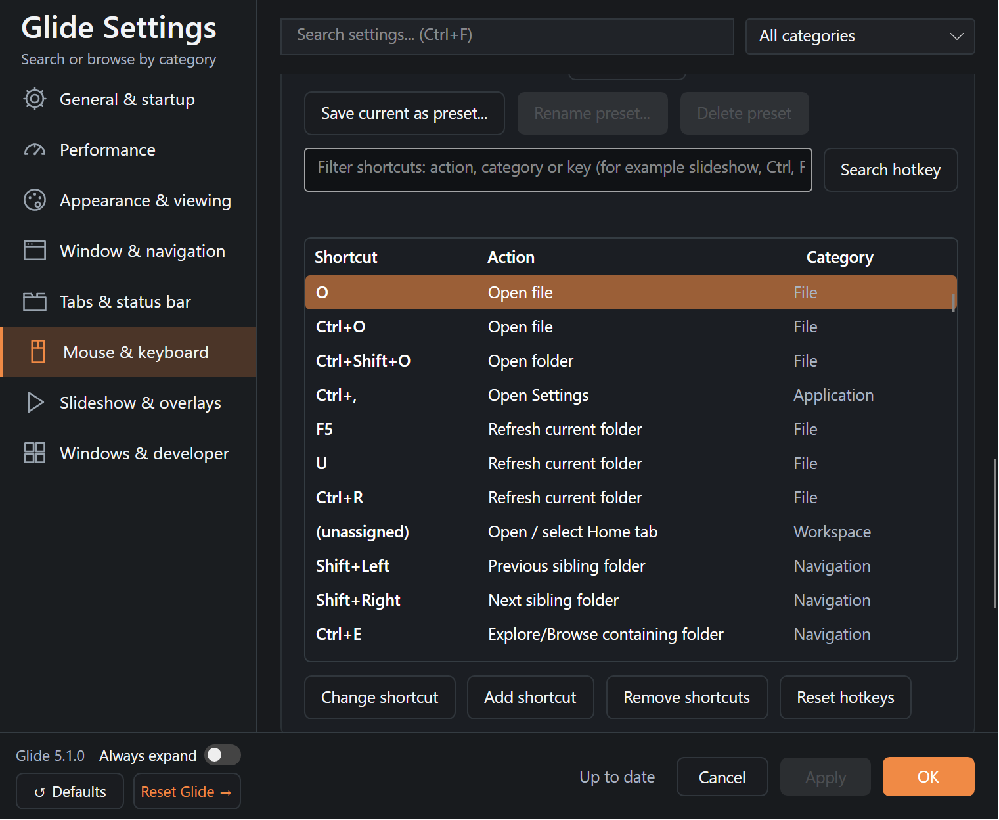

### Settings

Eight pages of collapsible cards with *N changed* badges and a search that opens and highlights the exact setting. Profiles, JSON export, **Back up and restore** to a `.glidebackup` file, and **Reset Glide**, which wipes exactly what you tick.

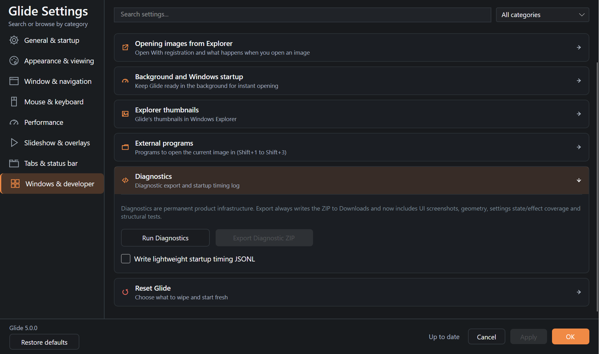

### More

* **Save / Save As**: `Ctrl+S` saves in place after confirmation, `Ctrl+Alt+S` converts to about 30 formats via a temporary file, keeping EXIF / XMP / colour profile where the format allows.
* **Print** (`Ctrl+P`): full-resolution output with an instant live preview, fit / fill / actual size / custom scale, alignment and margins.
* **Overlay mode** (`Alt+O`): all of Glide as a frameless, transparent picture window. Drag the picture to move it (zoomed in: bottom bar or `Alt+drag`), opacity slider with mouse wheel, sizes 25-200 % above the taskbar, optional drag strip and **Lock position**.
* **Window-in-Window overlays**: transparent reference images or videos with their own zoom, opacity and rotation; saveable layouts.
* **Slideshow**: interval, order, shuffle, loop, across folders.
* **Windows integration**: Open With for every format, Explorer thumbnails for every format Glide decodes, three external-program slots (`Shift+1/2/3`).
* **Privacy and security**: no telemetry; one daily update check to GitHub (off with one switch; Glide never downloads updates itself); SVGs can't fetch remote content; decoders are bounded against malformed files.

## Default shortcuts

All rebindable in Settings > Mouse & keyboard. *Glide default* preset:

| Action | Shortcut |
|---|---|
| Next / previous image | `Space`, `Right`, `Page Down` / `Left`, `Page Up` |
| Back / forward | `Alt+Left` / `Alt+Right`, `Shift+Backspace` (mouse side buttons only if bound in Mouse gestures; by default Glide leaves them to Windows / your mouse software) |
| Back, or previous image | `Backspace` |
| First / last image, sibling folder | `Home` / `End`, `Shift+Left` / `Shift+Right` |
| Fullscreen | `F`, `F11`, `Enter` |
| Zoom in / out | `+` / `-` |
| Fit image / window / width / height / actual size | `Shift+W` / `4` / `2` / `1` / `3` |
| Rotate, flip | `L` / `R`, `H` / `V` |
| GIF pause, previous / next frame | `P`, `,` / `.` |
| Slideshow, image info | `S`, `I` |
| Open file / folder / Settings | `Ctrl+O` / `Ctrl+Shift+O` / `Ctrl+,` |
| New / close / restore / duplicate tab | `Ctrl+T` / `Ctrl+W` / `Ctrl+Shift+T` / `Ctrl+Shift+K` |
| New window, close window | `Ctrl+N`, `Ctrl+Shift+W` |
| Status bar, show in Explorer | `Ctrl+Shift+B`, `Ctrl+E` |
| Copy / rename / delete | `Ctrl+C` / `F2` / `Delete` |
| Print / Save / Save As | `Ctrl+P` / `Ctrl+S` / `Ctrl+Alt+S` |
| External program 1 / 2 / 3 | `Shift+1` / `Shift+2` / `Shift+3` |
| Add overlay, Overlay mode | `Shift+O`, `Alt+O` |

## Formats

196 recognised extensions; whether one opens depends on its route (built-in decoder, codec module, WIC, Shell preview or optional codec). Added in 5.0.7: headerless DIB, Apple ICNS, Sun raster, XWD, DPX and OpenEXR DWAA/DWAB. Full route map: [format-coverage.md](docs/format-coverage.md).

<strong>All 196 extensions</strong>

.jpg, .jpeg, .jpe, .jfif, .jif, .jfi, .pjpeg, .pjpg, .png, .apng, .mng, .jng, .bmp, .dib, .rle, .wbmp, .tif, .tiff, .btf, .gif, .ico, .cur, .ani, .icns, .webp, .heic, .heif, .heics, .heifs, .hif, .avif, .avifs, .svg, .svgz, .jxr, .wdp, .hdp, .jp2, .j2k, .j2c, .jpc, .jpx, .jpf, .jpm, .mj2, .jxl, .psd, .psb, .pdd, .xcf, .ora, .kra, .afphoto, .afdesign, .afpub, .clip, .csp, .pdn, .psp, .pspimage, .pxr, .tga, .targa, .icb, .vda, .vst, .dpx, .cin, .sgi, .rgb, .rgba, .bw, .ras, .sun, .iff, .lbm, .ilbm, .img, .pic, .pict, .pct, .pict2, .eps, .epsf, .ai, .pdf, .pnm, .ppm, .pgm, .pbm, .pam, .pfm, .pcx, .qoi, .hdr, .rgbe, .xyze, .exr, .dds, .ff, .fits, .fit, .fts, .fts.gz, .hdr.gz, .xbm, .xpm, .xwd, .cut, .mac, .mpo, .jps, .pns, .dng, .cr2, .cr3, .crw, .nef, .nrw, .arw, .srf, .sr2, .raf, .orf, .ori, .rw2, .rwl, .pef, .ptx, .3fr, .fff, .iiq, .cap, .eip, .mef, .mos, .mrw, .x3f, .erf, .kdc, .dcr, .k25, .bay, .srw, .rwz, .gpr, .mdc, .raw, .r3d, .ari, .cinema, .dcs, .drf, .dsc, .r2d, .rw1, .dcm, .dicom, .ima, .nii, .nii.gz, .mha, .mhd, .nrrd, .ndpi, .svs, .vms, .vmu, .scn, .mrxs, .bif, .czi, .lif, .lsm, .ome.tif, .ome.tiff, .vsi, .ktx, .ktx2, .pvr, .astc, .basis, .tex, .vtf, .wal, .spr, .cdr, .cmx, .cpt, .emf, .wmf, .emz, .wmz, .dwg, .dxf, .skp

## Building from source

Run `build.cmd` (or `build.cmd fast --no-pause`) with the .NET 10 SDK (x64) and the Visual Studio C++ tools. Release builds produce the portable zip and the installer. Benchmarks live in `tools/perf` and `tools/bench-507`; settings and actions have audits (`python tools/audit-settings-search.py`, `python tools/audit-action-registry.py`).

## Documentation

[CHANGELOG](CHANGELOG.md) · [Release notes](docs/releases/) · [Actions and hotkeys](docs/ACTIONS-AND-HOTKEYS.md) · [Navigation history](docs/NAVIGATION-HISTORY.md) · [Format coverage](docs/format-coverage.md) · [Explorer thumbnails](docs/explorer-thumbnails.md) · [Print research](docs/print-research.md) · [Architecture handoff](docs/GLIDE_MANIFESTO_AND_HANDOFF.md) · [All docs](docs/README.md)

Thanks to vertigo220, whose reports and ideas shaped 5.0 ([feedback map](docs/releases/5.0.0-community-feedback.md)), and to everyone who tested 5.0.x and 5.1.

## License

Glide is free software under the [GNU General Public License v3.0 or later](LICENSE). Source: https://github.com/cobhc95/Glide. Bundled third-party components keep their own licences ([THIRD-PARTY-NOTICES.md](THIRD-PARTY-NOTICES.md)); an [additional permission under GPLv3 section 7](licenses/GLIDE-ADDITIONAL-PERMISSION.txt) allows combining Glide with the Ms-PL SVG libraries it uses. Contributions: [CONTRIBUTING.md](CONTRIBUTING.md).
