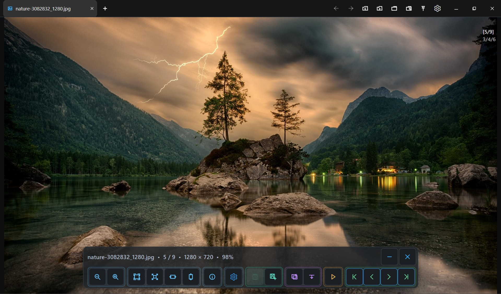
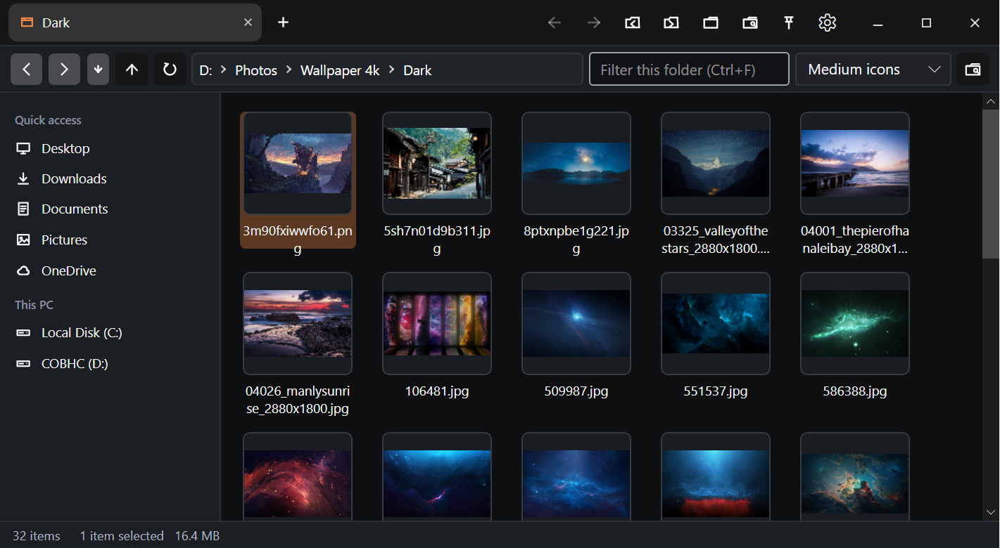
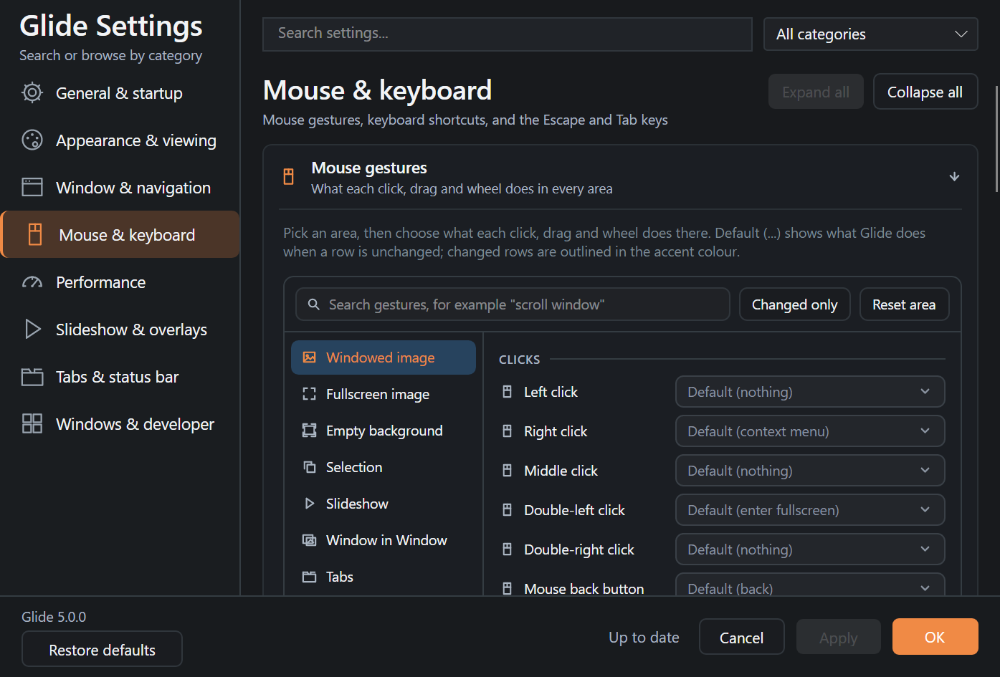
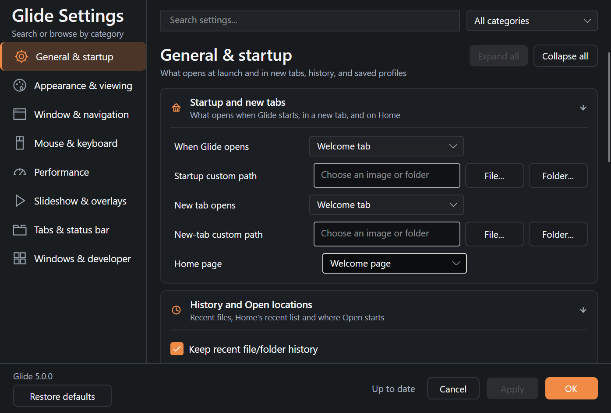
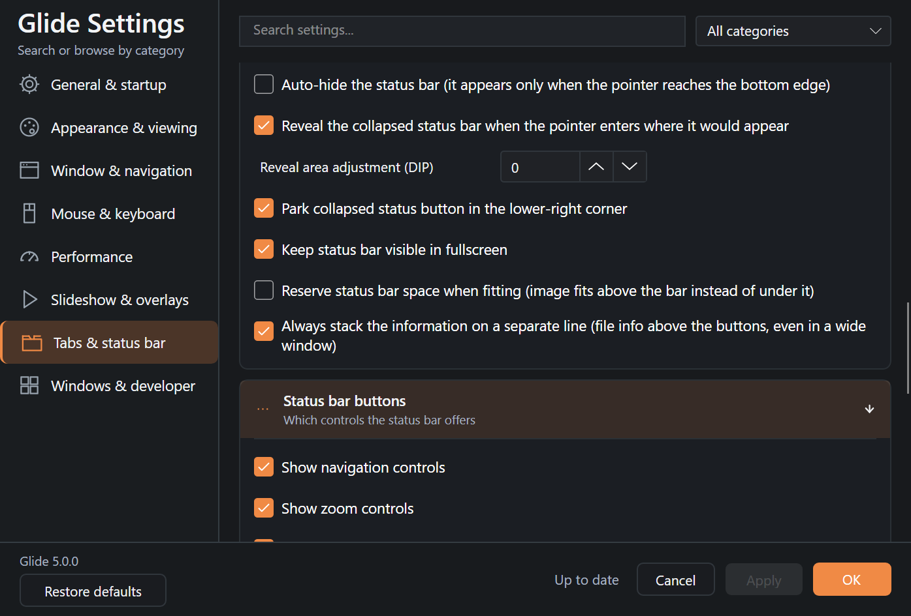

# Glide Image Viewer: faster, safer, with a built-in Explorer

🚀 **Large images open and settle up to 89 % faster and use half the memory, Glide has its own Explorer tab with browser-style Back / Forward, every mouse gesture lives in one panel, 132 settings can go on a key, Settings is a set of collapsible cards, and a full security review closed several privacy and hardening gaps.** 4.8.0 was never published, so everything built for it is in this release.

---

## ⚡ Speed showcase: v4 vs v5

Time to the final sharp frame at Fit (median ms, warm cache, lower is better). The bar shows how much time is gone.

| Format | v4 | v5 | Change | Faster |
|---|---:|---:|---:|---|
| 🖼️ JPEG, 24 MP | 83 | 46 | -45 % | ▓▓▓▓▓░░░░░ |
| 🖼️ Progressive JPEG, 50 MP | 978 | 107 | -89 % | ▓▓▓▓▓▓▓▓▓░ |
| 🖼️ PNG, 24 MP | 154 | 127 | -17 % | ▓▓░░░░░░░░ |
| 🖼️ WebP, 24 MP | 378 | 184 | -51 % | ▓▓▓▓▓░░░░░ |
| 🖼️ TIFF (LZW), 24 MP | 585 | 177 | -70 % | ▓▓▓▓▓▓▓░░░ |
| 🖼️ BMP, 24 MP | 123 | 27 | -78 % | ▓▓▓▓▓▓▓▓░░ |
| 🎞️ GIF, animated 1080p x 60 frames (first frame) | 6.0 | 5.0 | -16 % | ▓▓░░░░░░░░ |
| 💯 JPEG, 100 MP | 258 | 124 | -52 % | ▓▓▓▓▓░░░░░ |
| 💯 Progressive JPEG, 100 MP | 980 | 201 | -80 % | ▓▓▓▓▓▓▓▓░░ |
| 💯 TIFF (LZW), 100 MP | 2333 | 756 | -68 % | ▓▓▓▓▓▓▓░░░ |
| 💯 PNG, 100 MP | 634 | 530 | -16 % | ▓▓░░░░░░░░ |
| 💯 BMP, 100 MP | 362 | 98 | -73 % | ▓▓▓▓▓▓▓░░░ |
| 🧠 Peak memory of a full decode, 24 MP (MB) | 184 | 93 | -50 % | ▓▓▓▓▓░░░░░ |
| 🧠 Peak memory of a full decode, 100 MP (MB) | 770 | 385 | -50 % | ▓▓▓▓▓░░░░░ |
| 🔋 CPU to browse 21 x 24 MP images, 500 ms per step (s) | 11.5 | 4.8 | -58 % | ▓▓▓▓▓▓░░░░ |
| 🔋 CPU to browse 21 x 4K images, 500 ms per step (s) | 9.9 | 1.0 | -90 % | ▓▓▓▓▓▓▓▓▓░ |

➖ **Unchanged on purpose:** the very first frame of a JPEG (24 MP: 36.7 vs 37.2 ms; 100 MP: 118.6 vs 117.4 ms) is bound by the Windows codec; stepping through a folder with prefetch is a cache hit in both versions (about 0.15 ms); zoom and pan frame cost is the same. 🎞️ A 1080p 60-frame GIF now animates (in v4 it exceeded the animation memory budget and stayed still).

Method: headless benchmark harness (`tools/perf`) on an AMD Ryzen 7 9700X (16 logical CPUs, 61.6 GB RAM, Windows 11 24H2), factory defaults (Maximum quality, 2400 px preview cap, prefetch depth 15, 999 MB caches), 2560x1369 viewport, synthetic test images, medians of 5 warm runs (3 for 90 MP and above). "v4" is the pre-5.0 source (4.7.1 behaviour plus unreleased 4.8 work). Synthetic JPEGs are about half the size of real camera JPEGs, so absolute JPEG times are optimistic; the comparison is like-for-like. App launch to first frame improved 8 % for a 100 MP JPEG (810 to 744 ms, JIT build; the shipped NativeAOT build differs). Your numbers will vary.

---

## 📊 v4 vs v5 at a glance

**🗂️ Features and navigation**

| | v4 (4.7.x) | v5.0.0 |
|---|---|---|
| Explorer tab | ❌ (hidden and removed in 4.7.0) | ✅ thumbnails, file operations, session restore |
| Back / Forward history per tab | ❌ | ✅ up to 100 steps, title-bar buttons, `Alt+Left` / `Alt+Right` |
| Mouse side buttons | ➖ nothing until bound | ✅ Back / Forward by default |
| Animated GIF controls | ❌ | ✅ pause / play, frame stepping |
| Reset Glide | ❌ | ✅ |
| Auto-hide status bar | ❌ | ✅ |
| Folder as Custom startup / new-tab target | ❌ (image only) | ✅ |
| Largest image at full resolution | 256 MP | ✅ 512 MP with a free-memory check |

**🖱️ Input**

| | v4 (4.7.x) | v5.0.0 |
|---|---|---|
| Mouse gestures | ➖ fixed slots plus separate toggles | ✅ one panel, 9 areas, up to 6 custom gestures per area, every row searchable |
| Hotkey rows / gesture actions | 75 / 56 | ⬆️ more than 260 actions in one registry behind keys, gestures, buttons, menus |
| Settings bindable to a key or gesture | ❌ | ✅ 132 |
| Fixed keys visible in the hotkey list | ❌ | ✅ 21 |
| Sort, *Search hotkey*, custom presets, conflict prompt | ❌ | ✅ |

**🧩 Settings and windows**

| | v4 (4.7.x) | v5.0.0 |
|---|---|---|
| Settings layout | 8 pages, each one long scrolling list | ✅ 8 pages, 39 collapsible cards, *Open* jumps to and highlights the setting |
| Settings window | opens at 1040 x 760, minimum 760 x 560 | ✅ 930 x 630, minimum 720 x 480, remembers its size |
| Searchable settings entries | 202 documented at 4.6.0 | ⬆️ 269 |
| Remembered window placements | ➖ main window and Settings | ✅ every window, dialogs included |
| Status bar info line | one line in a wide window | ✅ stacked on its own row by default |

**🖨️ Print and thumbnails**

| | v4 (4.7.x) | v5.0.0 |
|---|---|---|
| Portrait / Landscape click | 540-570 ms (seconds on a network printer) | ✅ instant |
| Opening Print later in a session | about 550 ms | ✅ 35-61 ms |
| Grayscale preview of a 50 MP image | up to 256 ms | ✅ about 11 ms |
| Explorer thumbnails, 5000 files, visible tiles | 87 ms | ✅ 68 ms (-22 %); after a jump-scroll 58 to 31 ms (-46 %) |
| Thumbnail quality settings (Fast / Balanced / High) | ➖ saved but ignored | ✅ they work |

**🔐 Security**

| | v4 (4.7.x) | v5.0.0 |
|---|---|---|
| SVG linked remote images / UNC shares | ➖ could be fetched | ✅ removed before rendering |
| Imported profile changes external programs / brings network folders | ➖ possible | ✅ blocked |
| Malformed GIF (about 60 bytes) forcing a 2 GB allocation | ➖ possible | ✅ bounded |
| Single-instance hand-off | ➖ not user-private | ✅ private per Windows user |
| Optional FFmpeg decoder | verified when downloaded | ✅ verified on every load |
| Installer custom folders / Launch Glide | ➖ per-user registry trusted, elevated launch | ✅ locked down, no elevated launch |

---

## 🆕 What's new

- 🗂️ **Explorer tab**: breadcrumb bar, navigation pane, icon / List / Details views with sortable columns, filter (`Ctrl+F`), background thumbnails, right-click menus, rename (`F2`), Recycle Bin delete, copy / cut / paste with the Windows clipboard, new folder, drag and drop; double-click and middle-click open an image in the current or a new tab (your choice).
- ♻️ **Open last session** restores each Explorer tab's folder, selected file and scroll position, even after a crash.
- ⏪ **Back / Forward** in every tab like a web browser (`Alt+Left`, `Shift+Backspace` / `Alt+Right`, mouse side buttons, title-bar buttons); `Backspace` = Back, or Previous image.
- 🖱️ **Mouse gesture panel**: Windowed / Fullscreen image, Empty background, Selection, Slideshow, Window in Window, Tabs, Title bar, Explorer; custom gestures; compact action picker; Shift / Alt + wheel; tab and title-bar clicks.
- ⌨️ **One master action list** behind hotkeys, gestures, title-bar and status-bar buttons, menus and search: 132 settings as *Toggle:* / *Cycle:* actions, 22 click-only commands now with hotkeys, fixed keys listed, sortable list, *Search hotkey*, custom presets, conflict prompt, *Exit Glide* action.
- 📊 **Status bar**: *Always stack the information on a separate line*, *Auto-hide status bar*, reveal area equal to the bar's box with an adjustment, *Reserve status bar space when fitting*, *Tab tooltip text size*.
- 🧹 **Reset Glide** (Settings > Windows & developer): ten tick boxes, a confirmation listing exactly what goes, optional backup, HKCU-only.
- 🪟 **Window memory** for Settings, Print, the title-bar customiser, Diagnostics results and every dialog.
- 🎞️ **GIF controls** (`P`, `,` `.`) · 📁 folders as startup and new-tab targets · 🖼️ 512 MP images · 🖨️ instant print preview · 🔎 Settings search finds every gesture row and Reset item.

## 🎨 UI refresh

- 🧩 Settings in **collapsible cards** (39 cards, 8 pages) with *Expand all* / *Collapse all*, *N changed* badges and *Page > Card* search results.
- 📐 Compact Settings window **930 x 630** (was 1040 x 760) that works at 720 px wide and remembers size, position and per-page scroll.
- 🗂️ Settings moved to where they belong (folder position line with the text overlay, all status bar settings together, Speed Boost under *Windows & developer*); *Interface & window* is now *Window & navigation*; clearer names (*Show status bar*, *Show text overlay*).
- ⏪ Back / Forward lead the title bar; more title-bar buttons to choose from; menus show your assigned keys.
- 📊 Taller status bar with a stacked info line; a very small collapsed arrow that reads on dark and bright images.

## 🐞 Bug fixes

**🗂️ Explorer and thumbnails**
- *Show in Windows File Explorer* opened Documents · external programs 1-3 used the picture of another tab (now the selected image) · typing in Explorer text boxes triggered viewer hotkeys.
- Thumbnail quality / decode size / embedded-preview settings were ignored · rotated photos sideways or blurry · small camera previews stretched · GIF first frames mis-placed or blank · status line said *Provider: missing* · *Custom* mode switched thumbnails off.

**⌨️ Keyboard and hotkeys**
- Shortcuts saved in another modifier order never fired (also *Alt+Shift+S*) · Space / Enter clicked the last toolbar button again · `Ctrl+Tab` ignored your keys · Tab and arrow combinations could not be recorded or searched.
- Image shortcuts (Delete, F2, R, Ctrl+C, Ctrl+P, arrows and about 30 more) acted on the hidden picture of another tab · *Explore/Browse containing folder* did nothing · zoom step setting had no effect · Fit hotkeys ignored *Fit control scope* · *Exit program* only closed one window · the shortcut list stopped scrolling under a tooltip.

**🖱️ Mouse and gestures**
- Right-click outside the image opened the menu on press, so right-click + wheel popped it up · the pointer vanished over menus in fullscreen · leaving fullscreen flashed the window at the wrong place.

**📊 Status bar**
- The hover-revealed bar hid while you reached for it · the auto-hide reveal area was about 40 DIP too wide · the collapsed expand button drifted from the collapse button's spot · *Reveal the collapsed status bar* could not be switched off (two checkboxes).

**🧩 Settings**
- Settings forgot each page's scroll position · the rate-limit note showed the wrong default (80 ms) · an empty `%TEMP%` folder was created on every open · three settings with no effect were removed (back / forward tab-bar buttons, folder *Explore*).

**🖨️ Print**
- Portrait / Landscape, scaling, margins, alignment, colour and copies lagged on every click · switching back to Portrait did not update the preview · *Custom scale %* and *Keep aspect ratio* were enabled for modes that ignore them.

**🖼️ Images and memory**
- A cache-rejected frame was disposed then still shown · stale rapid-browse previews never disposed · a cached frame could be evicted before it was attached · a failed preload freed its native buffer twice · a 1080p x 60 GIF stayed static (animation budget).

**🚀 Startup paths**
- Custom startup and new-tab paths ignored folders (now an Explorer tab) · an unusable path failed silently (now the Welcome page says why) · the *File...* picker accepted everything (now images, with *All files*) · pasted paths with quotes or `%VARIABLES%`.

## 🔐 Security

- 🛡️ **SVG** can no longer fetch web, network-share or relative images (no IP or NTLM leak) · imports keep your external programs, drop network folders and are refused above 16 MB · **malformed GIFs** and **PSD** files are bounded · 512 MP limit and memory guard on every decode path, including startup from Explorer.
- 🔒 Single-instance hand-off private to your Windows user · installer no longer trusts a per-user registry value, launches Glide without elevation and locks down custom install folders · no DLLs loaded from the image's folder · Explorer-tab paste ignores relative clipboard paths · permanent delete never follows junctions.
- 🧰 FFmpeg decoder verified on every load (pinned size and SHA-256, files held open) · thumbnail provider caps the drawn size at 2048 px · both native DLLs built with CFG, CET, ASLR and `/sdl` · Reset Glide limited to HKCU by construction · dev signing script no longer trusts its own certificate by default · unused network-download and disk-cache code removed · Svg.Skia updated.
- 🔎 The audit also found no issue in the native decoders' size checks, the IPC parser, file operations, file associations, metadata parsing or codec-provider loading. Glide still makes no network requests except the optional, confirmed FFmpeg download.

## 🧹 Code health

- 🔁 One master action registry replaces separate hotkey, gesture, title-bar, menu and status-bar lists; all 78 historical default shortcuts proven through the real key handlers; 12 vacuous UI tests now really run.
- 🧼 Dead code removed (about 126 files touched, roughly 835 fewer lines, about 350 unused `using` lines) · `SettingsWindow` split into partial files (3,635 to 2,385 lines) · command-line modes out of `Program.Main` · shared key-text, overlay-motion and shell-launch helpers.
- 🧪 Tests: Core 1258, Input 21, Explorer 125 pass; settings audit 269 entries / 39 cards / 8 pages; action-registry audit passes · new `tools/perf` benchmark harness and security tests.
- 🧱 Deterministic bitmap lifetime (leases, exactly-once disposal) · native build hardening · settings schema 11 with careful one-time migrations · repository tidy-up (`docs/releases/`, `tools/`, archives).

## ⚠️ Behaviour changes to know about

- ⌨️ **`Ctrl+Shift+B`** replaces `Alt+Shift+S` for show / hide status bar · **`Backspace`** is *Back, or Previous image* (it no longer goes Up in the Explorer; use `Alt+Up`) · **`Ctrl+E`** shows the folder in Explorer · image shortcuts only work while a picture is shown.
- 🖱️ **Mouse side buttons go Back / Forward** (choose *Do nothing* to undo) · right-click menus appear on button release · shortcuts saved in another modifier order now work.
- 📏 **Zoom step** now works (default 15 %, wheel 80 % of it) · **Fit hotkeys** follow *Fit control scope* · **Exit Glide** quits everything, *Close Glide window* closes one.
- 📊 **Taller status bar** by default (switch off *Always stack the information on a separate line*) · hover reveal on by default and set only in Settings · *Show in Explorer* opens Glide's own Explorer tab (right-click it for Windows File Explorer).
- 🧩 Settings opens smaller and every window remembers its place · new installs default to Maximum quality browsing · Custom startup / new-tab **folders** open an Explorer tab.
- 🔐 A running 4.x and 5.x Glide no longer hand images to each other and an administrator Glide opens its own window · SVG no longer loads linked images · GIF frames larger than the canvas and 1 MP are skipped and animations play at most 10,000 frames · 512 MP limit (was 256) with a memory check · imports keep this PC's external programs and drop network folders · custom install folders outside Program Files and your profile become admin-writable only.
- 🧠 Back / Forward never fire while typing; an image opened in a new tab starts without history; history is kept while Glide runs.

## 📦 Downloads

| File | What it is |
|---|---|
| `Glide.Setup.exe` | Installer (requires administrator rights; installs to Program Files, adds Open With and Explorer thumbnails) |
| `Glide-5.0.0-Portable.zip` | Portable build: extract anywhere and run `Glide.exe` |
| `Glide.Setup.sha256` | Installer checksum |

🔑 **SHA256 of `Glide.Setup.exe`:** `24FA8E1100D6C80AA3E9FEBF158F282C7D8D3F9DA419D64DE47D459B0BF29F3B` (verify with `certutil -hashfile Glide.Setup.exe SHA256`).

- 🔼 **Upgrade notes:** settings carry over (schemas 7 to 11 migrate once; your own key bindings and customised title bar are kept) · if you changed the Explorer thumbnail quality, click *Apply thumbnail settings* then *Refresh thumbnails* once · an image over about 67 MP may stay on its sharp preview when free memory is low · imported profiles no longer set external programs or network folders.
- 💻 **Requirements:** Windows x64, no .NET runtime required. 5.0.0 is built on .NET 8 (support ended 2026-11-10) and is self-contained.

## 🙏 Thanks

Thanks to **vertigo220** for the many detailed bug reports and feature ideas that shaped this release: the numbered follow-ups on issue #1 (reserve space when fitting, tab tooltip size, the collapsed expand button and auto-hide status bar, per-page Settings scroll memory, the fullscreen-exit flicker, hotkey conflict warnings, sortable shortcuts, *Search hotkey*, custom presets, the right-click menu timing), the Explorer tab request with session restore, and the GIF controls. See [the full map of what was reported and where it shipped](https://github.com/cobhc95/Glide/blob/main/docs/releases/5.0.0-community-feedback.md).

## 🔮 Coming next

🧭 A migration to **.NET 10 LTS**: see [docs/NET10-MIGRATION-PLAN.md](https://github.com/cobhc95/Glide/blob/main/docs/NET10-MIGRATION-PLAN.md).

📜 **Full changelog:** [CHANGELOG.md](https://github.com/cobhc95/Glide/blob/main/CHANGELOG.md) · everything from [4.7.1](https://github.com/cobhc95/Glide/releases/tag/v4.7.1) is included.
